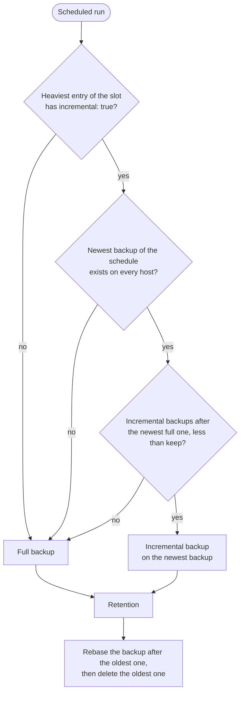
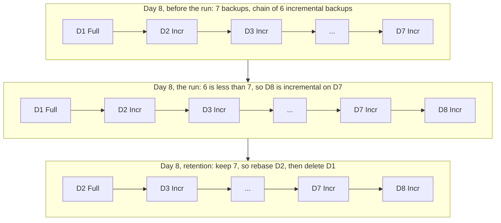

# Backup internals

> **EXPERIMENTAL.** See [backup.md](backup.md) for the user guide. This page tells how operator-managed backup
> works: what the operator runs on the sidecars, which checks it makes, and why. Read it to debug a problem, or to
> run backups in a setup that the user guide does not cover.

## Overview

```
spec.backup / clusters[].backup ──► operator ──► clickhouse-backup sidecar in every Pod ──► backup storage
                                                              ▲
ClickHouseBackup         ──► run per cluster ─┐               │ system.backup_actions, system.backup_list
ClickHouseBackupSchedule ──► run per cluster ─┼── operator ──► SQL to the ClickHouse of every host
ClickHouseRestore        ──► run per cluster ─┘
```

The operator runs every resource itself, with one run per cluster. It sends `clickhouse-backup` commands to the
sidecars through SQL, by the [integration tables](#integration-tables) of each host. It creates no `Job`,
`CronJob` or Pod for this.

## Enabling backup in detail

* A cluster inherits every field it leaves empty from `spec.backup`, as with `spec.security`.
* The operator reads `recovery` from the CHI only. So a template that many CHIs use cannot make each
  of them restore the same backup.
* The operator refuses a `secretKeyRef` without `key`, with `hotReload: true` or with
  `optional: true`.
* `podTemplate` does not replace a storage. Each backup-enabled cluster needs a usable storage Secret.
* The operator checks only the CHI fields. Settings that a mutating admission webhook adds do not
  count.
* A configuration file that a pod template mounts at `/etc/clickhouse-backup` is replaced by the file
  of the operator.
* Enabling or disabling backup rolls only the Pods of that cluster. The other clusters reload their
  users configuration live when the operator adds or removes the backup user (see below).

## What the operator runs

For every Pod of a cluster with backup enabled, the operator adds a container named
`clickhouse-backup` that runs `clickhouse-backup server`:

* **REST API on port 7171** (container port `backup-api`). The operator drives the sidecar through
  the [integration tables](#integration-tables), which ClickHouse in the same Pod reads from
  `http://127.0.0.1:7171`. The port is also on the Service of each host, for tools that call the API
  directly. The operator does not use it there. Only `ClusterIP` Services (the default, headless too)
  get the port. A host Service of type `LoadBalancer`, `NodePort` or `ExternalName`, or a `ClusterIP`
  Service with `externalIPs`, does not, so the plain-HTTP API is never published outside the
  Kubernetes cluster. The operator gives a `BackupAPIUnpublished` event for such hosts. The API can
  run commands in the sidecar, so restrict access to it, see
  [Limitations and security notes](backup.md#limitations-and-security-notes).
* **Credentials Secret `<chi-name>-auto-backup-secret`.** One per CHI, owned by the CHI, so it is
  deleted with the CHI. It holds:
  * `API_USERNAME`, `API_PASSWORD`: the basic-auth credentials of the REST API. The operator
    generates random values, the same for every cluster of the CHI. The sidecars read them from their
    configuration file, and the integration tables send them in their URL.
  * `CLICKHOUSE_USERNAME`, `CLICKHOUSE_PASSWORD`: optional, added by you. The operator has no
    defaults for them. See the backup user below.
* **Configuration file Secret `<chi-name>-<cluster-name>-backup-config`.** One per backup-enabled
  cluster, owned by the CHI. The operator generates it from the [storage Secret](backup.md#backup-storage) of
  the cluster and the credentials above. Its `config.yml` is mounted read-only into the sidecar only,
  at `/etc/clickhouse-backup/config.yml`, where `clickhouse-backup` looks for it. `clickhouse-backup`
  reads the file again for every operation, and Kubernetes updates a mounted Secret. So a changed
  storage Secret reaches a running sidecar without a restart, see [Secret changes](#secret-changes).
  The Secret also holds the storage location settings under their environment variable names, for
  the [storage path check](#storage-paths).

  A sidecar that starts before this Secret exists does not start its REST API, because the API would
  then accept requests without credentials. It waits for the file, and the Pod stays Ready.

  The name joins the CHI name and the cluster name with `-`. So CHI `a-b` with cluster `c` and CHI
  `a` with cluster `b-c` give the same name. The operator changes only a Secret that has its labels
  for this CHI. When a Secret of that name has no such labels (it belongs to another CHI, or to you),
  the operator changes nothing. It aborts the reconcile of the CHI with the reason
  `BackupConfigInvalid` and a message that names the Secret. It continues when the Secret is gone, or
  when the CHI or the cluster gets another name.
* **Backup user, when you set one.** Without `CLICKHOUSE_USERNAME` and `CLICKHOUSE_PASSWORD` in the
  credentials Secret, the configuration file sets no ClickHouse credentials (the storage settings
  can still set them). `clickhouse-backup` then uses its defaults: user `default`, empty password,
  from `localhost`. When you set both, the operator adds that user to the CHI, with the password from
  the Secret and access from localhost only (`127.0.0.1`, `::1`). So only the sidecar in the same Pod
  can log in. ClickHouse counts every address of the Pod as local, so another client in the same Pod
  can also log in through the Pod IP or the host Service. Other Pods cannot.
  * The operator reads the password while it normalizes the CHI. When the Secret exists but cannot
    be read, the operator aborts the CHI with `[BackupSecretUnresolved]`, and does not reconcile it
    without the user. The CHI stays aborted until the next reconcile with a readable Secret: after a
    spec edit, an operator restart, or auto-recovery when a Pod becomes Ready.
  * With only one of the two keys set, the operator adds no user, and the sidecar connects with what
    is set. A `BackupCredentialsIncomplete` event on the CHI, on every reconcile, names the key that
    is set and the key that is missing.
  * Without backup enabled, a user of that name in the CHI is an ordinary user.

**Settings the operator gives the sidecar:**

* **Local connection.** The sidecar connects to `localhost` on the native TCP port of the host, or on
  the secure TCP port with TLS when the host exposes only that one.
* **`RESTORE_SCHEMA_ON_CLUSTER` is empty**, so that nothing else turns it on. A restore sets it for
  its own command only, on the first replica of the first shard (see
  [ClickHouseRestore](backup.md#clickhouserestore)). The replicas of a restored `Replicated*` table then share
  one Keeper path. This needs ZooKeeper or ClickHouse Keeper for the CHI, as replication does.
* **`clickhouse.restore_distributed_cluster` is `{cluster}`**, as in the Altinity usual backup
  workflow. Every replica except the first replica of the first shard restores its schema without
  `ON CLUSTER`. On these replicas, a `Distributed` table of the backup over a cluster that the host
  does not have (for example, the cluster of the source CHI under another name) is pointed at the
  restored cluster. A `Distributed` table over a cluster that the host has, or over a macro, does not
  change. The storage settings can set another value, or `""` to turn this off, see
  [Backup storage](backup.md#backup-storage).
* **`RESTORE_DATABASE_MAPPING` and `RESTORE_TABLE_MAPPING` are empty.** A restore creates every
  table under its name in the backup, or in the database that the `databaseMapping` of the restore
  maps it to. A mapping in the sidecar would make every restore drop and replace other tables than
  it names.
* **`CLICKHOUSE_RESTART_COMMAND` is `sql:SYSTEM RELOAD USERS; sql:SYSTEM RELOAD CONFIG`**, as in the
  Altinity usual backup workflow. ClickHouse then loads restored users, roles, grants and
  configuration without a restart. The `clickhouse-backup` default,
  `systemctl restart clickhouse-server`, cannot work in a sidecar. See
  [Access entities](#access-entities).
* **`API_ALLOW_PARALLEL` is `false`.** A sidecar runs one backup or restore command at a time and
  refuses others meanwhile. The operator waits.
* **`TZ` is `UTC`.** `clickhouse-backup` writes `start` and `finish` of a `system.backup_actions` row
  in the local time of its container, without a time zone
  ([Altinity/clickhouse-backup#1687](https://github.com/Altinity/clickhouse-backup/issues/1687)). The
  operator compares them with `now('UTC')` of ClickHouse.
* **`BACKUPS_TO_KEEP_LOCAL` is `-1`.** The local copy of a backup is deleted from the data disk after
  the upload. Local copies are hard links that keep old data parts on the disk, and they would grow
  without limit.
* **Remote retention belongs to the schedules only.** `general.backups_to_keep_remote` is `0`, and
  `general.rebase_during_delete` and `general.rebase_before_remove_old_remote` are `true`, whatever
  the storage settings say. Only the
  [retention](#retention) of the schedules deletes remote backups. Before it deletes a backup that
  another backup is incremental to, it rebases that other backup.
* **Default storage paths.** When the storage settings set no path, the configuration file uses
  `backup/{namespace}/{installation}/{cluster}/{shard}`, and
  `object_disks/{namespace}/{installation}/{cluster}/{shard}` for object disks, or the paths of the
  operator configuration. This applies to every storage type, see [Storage paths](#storage-paths). A
  path in the storage Secret or in the `env` of the container is used as it is.
* **Same volumes as ClickHouse.** The sidecar mounts every volume that the `clickhouse` container
  mounts, so it sees all data disks. See [Data volume](#data-volume).
* **Security context.** When the sidecar container in its pod template sets a `securityContext`, the
  sidecar uses it. Otherwise the sidecar copies the context of the ClickHouse container as it is
  (`readOnlyRootFilesystem`, capabilities and all). So Pods that pass Pod Security admission or a
  policy engine without the sidecar also pass with it. When the copy names no user, the platform
  assigns one, as OpenShift does. On plain Kubernetes, a context that requires `runAsNonRoot` but
  names no user stops the `clickhouse-backup` image, which runs as root by default. The Pod never
  becomes Ready, and the rollout stops at the first host. In that case, set the user in the
  `securityContext` of the `clickhouse-backup` container, or at the pod level of the pod template
  that the hosts run.
* **Resources.** The sidecar has no resource requests or limits unless its container sets them. Set
  them where a policy or a `LimitRange` requires them on every container. Without them, a ClickHouse
  Pod of QoS class `Guaranteed` becomes `Burstable`. It then loses the lowest OOM-kill priority and,
  under the `static` CPU manager policy, the exclusive CPUs of its ClickHouse container. To keep the
  Pod `Guaranteed`, give the sidecar requests equal to its limits.

**Precedence**, from lowest to highest:

1. The configuration file: the storage settings of the storage Secret, with the default paths filled
   in. The credentials above replace any `api.username`, `api.password`, `clickhouse.username` and
   `clickhouse.password` of the storage settings.
2. The environment of the sidecar: the operator settings above, and the `env` of the sidecar
   container in its pod template.

An environment variable overrides the file setting it stands for. The operator sets
`general.disable_environment_override: false` in the file, so the storage settings cannot turn this
off. So a storage setting that collides with an operator setting is ignored.

**Pinned settings.** The operator always sets these 13 variables, over the values of the container:
`API_LISTEN` (`0.0.0.0:7171`), `API_SECURE` (`false`), `API_CREATE_INTEGRATION_TABLES` (`true`),
`API_INTEGRATION_TABLES_HOST` (`127.0.0.1`), `RESTORE_SCHEMA_ON_CLUSTER`, `RESTORE_DATABASE_MAPPING`,
`RESTORE_TABLE_MAPPING`, `API_ALLOW_PARALLEL`, `CLICKHOUSE_RESTART_COMMAND`, `BACKUPS_TO_KEEP_REMOTE`,
`REBASE_DURING_DELETE`, `REBASE_BEFORE_REMOVE_OLD_REMOTE` and `TZ` (`UTC`). It removes
`API_USERNAME`, `API_PASSWORD`, `CLICKHOUSE_USERNAME`, `CLICKHOUSE_PASSWORD` and
`CLICKHOUSE_BACKUP_CONFIG` from the `env` of the container. These would override the credentials of
the file, or make `clickhouse-backup` read another file. The operator needs all of them. The
integration tables reach the sidecar at `127.0.0.1:7171` over plain HTTP, with the credentials of
`<chi-name>-auto-backup-secret`, and the list above gives the other reasons. The default storage
paths are not pinned: they only fill in a path that is not set.

A Kubernetes Service in the namespace sets `<SERVICE>_PORT=tcp://<ip>:<port>` in every container.
For example, a Service named `sftp` sets `SFTP_PORT`. `clickhouse-backup` cannot parse it and refuses
its whole configuration. So the sidecar sets `CLICKHOUSE_PORT` itself, and starts the server without
any `*_PORT` variable that holds such a link. A port set in the storage settings or in the `env` of
the container is kept.

### Customizing the sidecar

The sidecar is built on the `clickhouse-backup` container of the pod template that `podTemplate`
names, at the installation level or for one cluster. The operator keeps what the container sets and
fills in what it lacks. Without `podTemplate`, it builds the sidecar on its own.

* Only that container is taken, not the other containers, the volumes or the pod settings of the
  template. So it may be a pod template of its own, or the one the Pods of the cluster run.
* Every host of the cluster builds its sidecar on that one container, whatever pod template it runs.
* Each host takes the pod settings, such as the `imagePullSecrets` of a private sidecar image, from its
  own pod template.

```yaml
spec:
  backup:
    enabled: "yes"
    podTemplate: backup-sidecar
    storageConfig:
      valueFrom:
        secretKeyRef:
          name: backup-demo-storage
          key: config.yml
  templates:
    podTemplates:
      - name: backup-sidecar
        spec:
          containers:
            - name: clickhouse-backup
              image: altinity/clickhouse-backup:2.8.1
              imagePullPolicy: IfNotPresent
              resources:
                requests:
                  cpu: 100m
                  memory: 256Mi
```

A `ClickHouseInstallationTemplate` may carry both `spec.backup.podTemplate` and the pod template it
names, to give every installation that uses it the same sidecar.

* **You set:**
  * `image`. Default: `altinity/clickhouse-backup:stable`.
  * `imagePullPolicy`. Default: `Always`, so a moved `stable` tag is pulled at the next Pod start.
    For reproducible Pods, pin a version and use `IfNotPresent`, as above.
  * `env`, over the configuration file and the operator defaults.
  * `envFrom`. It sets what no `env` entry sets, over the configuration file.
  * `resources`. Without it the sidecar has none, see [What the operator runs](#what-the-operator-runs).
  * `securityContext`. Without it the sidecar copies the context of the ClickHouse container.
  * `volumeMounts` (of volumes that the Pods have), `command`, `args`, `livenessProbe`.
* **Pinned:** the 13 [pinned settings](#what-the-operator-runs) override the values of the container.
* **Removed:** the `env` entries `API_USERNAME`, `API_PASSWORD`, `CLICKHOUSE_USERNAME`,
  `CLICKHOUSE_PASSWORD` and `CLICKHOUSE_BACKUP_CONFIG`. Also every mount at, below or above
  `/etc/clickhouse-backup`, in the sidecar and in the ClickHouse container, whose mounts the sidecar
  shares. The configuration file of the operator replaces them. A pod template volume named
  `clickhouse-backup-config` is replaced by the volume of the operator.
* **Refused:** the operator aborts the CHI with `InvalidPodTemplate` before it changes anything when:
  * a literal `API_SECURE` turns TLS on. The integration tables use plain HTTP, and the operator does
    not turn TLS off without asking.
  * `podTemplate` names a pod template that does not exist, that has no `clickhouse-backup` container
    or two of them, or whose container uses a volume that only that pod template declares.
  * another pod template that the hosts of a backup-enabled cluster run has a `clickhouse-backup`
    container. Their Pods run the sidecar of the operator under that name. Name that pod template in
    `podTemplate` instead.

The ClickHouse container of a pod template is the one named `clickhouse`, else its first container
that is none of the operator's sidecars (`clickhouse-backup`, `clickhouse-log`), so the sidecar may
be listed anywhere. A pod template holding nothing but the sidecar gets the default ClickHouse
container.

Changing the container rolls the cluster's Pods.

With a `command` or `args`, the sidecar needs the configuration file Secret to start. The operator
then mounts it as mandatory, because another command could serve the REST API without credentials.
The `*_PORT` service link variables (see above) then stay set. The sidecar still reads the
configuration file of the operator, unless the command names another file with `-c` or `--config`.
Such a file, and an `envFrom` of the container, hide the storage paths from the operator, see
[Storage paths](#storage-paths).

A `clickhouse-backup` container in a pod template a cluster with backup off runs is that cluster's
own, run as written.

### Data volume

`clickhouse-backup` works on the files of ClickHouse directly. For a backup, ClickHouse freezes the
data parts as hard links in its data directory, and the sidecar uploads them from there. For a
restore, the sidecar downloads into that directory, and ClickHouse attaches the parts. So the sidecar
must share the volume of `/var/lib/clickhouse` with the `clickhouse` container. It does this by
mounting the same volumes.

When the `clickhouse` container mounts nothing at `/var/lib/clickhouse` (or at a directory above
it), there is no volume to share: the data lives in the container's own filesystem. The operator
then adds an `emptyDir` volume mounted at `/var/lib/clickhouse` in both containers, so backups and
restores still work. An `emptyDir` survives container restarts but not the Pod: its data is lost
whenever the Pod is deleted, evicted or moved to another node. That is fine for tests. Production
clusters need a PersistentVolumeClaim, e.g. a `dataVolumeClaimTemplate`, sized for the data plus
one downloaded copy of a backup.

## Integration tables

`clickhouse-backup` creates tables in ClickHouse that show its backups and the operations of its
REST API:

* `system.backup_list`: the backups, local and remote, with their sizes.
* `system.backup_actions`: the operations that run and ran.
  `INSERT INTO system.backup_actions(command) VALUES ('...')` starts one.
* `system.backup_version`.

They are `URL` engine tables that read `http://127.0.0.1:7171/backup/...`, the REST API of the
sidecar in the same Pod. The URL holds the API credentials of the configuration file.

The operator runs every backup and restore through these tables, see
[How the operator runs an operation](#how-the-operator-runs-an-operation). So it always turns them
on (`api.create_integration_tables: true`, `api.integration_tables_host: 127.0.0.1`), whatever the
storage settings say. Every ClickHouse user who can run
`SHOW CREATE TABLE system.backup_list` sees the API credentials in the URL. You can read the tables
too:

```sql
SELECT name, created, data_size, location, desc FROM system.backup_list ORDER BY created;
SELECT command, status, start, finish, error FROM system.backup_actions ORDER BY start DESC LIMIT 10;
```

The sidecar creates the tables when its server starts or reloads (`POST /restart` or `SIGHUP`), and
only when ClickHouse answers at that time. A sidecar that started before ClickHouse accepted
connections has no tables until it restarts. Until then the operator cannot use it: a run that finds
no `system.backup_actions` on a host fails with the error of that host.

## Storage Secret

Settings that `clickhouse-backup` does not know are passed on as they are. A newer image may take
settings that the operator does not know.

**`clickhouse.restore_distributed_cluster`** (`CLICKHOUSE_RESTORE_DISTRIBUTED_CLUSTER`). Default:
`{cluster}`, see [What the operator runs](#what-the-operator-runs). To point such `Distributed`
tables at another cluster of the CHI, name that cluster here. To keep them as the backup has them,
set `""`. Do not name the helper clusters `all-sharded`, `all-replicated` or `all-clusters`. They
span the hosts of every cluster, so a `Distributed` table over one of them reads every cluster.

**`BACKUPS_TO_KEEP_LOCAL`** is an environment variable that the operator sets. So
`general.backups_to_keep_local` in the storage settings is ignored. To keep local copies, set the
variable in the `env` of the sidecar container.

**When the Secret is not usable.** The reconcile of the CHI does not continue without a usable
Secret, see [Enabling backup](backup.md#enabling-backup). The operator aborts the reconcile of the whole CHI
before it creates or changes anything when the storage Secret:

* does not exist (not created yet, or a wrong name in `storageConfig`),
* has no `key`, or an empty one (as a Secret of environment variable keys has),
* holds settings that are not a YAML mapping of sections: not YAML at all, a section that is not a
  mapping, or a list where the operator reads a setting.

The CHI status becomes `Aborted`, with the reason `BackupConfigInvalid` and a message that names the
cluster, the Secret and the problem. For YAML that cannot be read, the message gives the line at
most, never the content, because the content holds credentials. A `BackupStorageConfigInvalid`
warning event goes to the CHI. The operator does not watch the Secret. It checks the storage Secrets
of such a CHI once a minute, and reconciles the CHI again when they are usable.

A Secret can go bad after the configuration file was generated (for example, it is deleted and then
created again). The sidecars then keep their current storage settings. The operator gives a
`BackupStorageSecretMissing` warning event, or `BackupStorageConfigInvalid` for settings that cannot
be read, until the Secret is correct. A reconcile of the CHI in this time aborts as above. When the
Secret is correct again, the sidecars use it without a restart, as they do with every later change,
see [Secret changes](#secret-changes).

## Secret changes

The sidecar reads its configuration file anew for every operation, from the configuration file
Secret the operator generates for its cluster out of the storage Secret and
`<chi-name>-auto-backup-secret`. The operator regenerates it on every reconcile of the CHI. For a
CHI that has completed a reconcile and is not suspended, it also does this once a minute, because it
does not watch Secrets it did not create. Kubernetes then updates the mounted file, which takes about
a minute more. Creating the storage Secret after the Pods, editing it, or deleting and recreating it with
other contents therefore takes effect by itself:

* **Within a few minutes, without a restart.** ClickHouse and the sidecar do not restart, and the
  Pod stays Ready. The operator updates the generated Secret only when its content changes.
* **For the next operation.** An operation that runs keeps the settings it started with. The next
  operation uses the new settings. A run starts its steps on the hosts of its cluster at different
  times. So a change during a backup or restore can give the old settings to some hosts and the new
  settings to others. Change the storage Secret only when no backup or restore runs.
* **A removed setting is removed.** The file is generated from the Secret as it is, so a setting that
  you remove from the Secret is also gone from the file. Exception: when the storage Secret is
  deleted, or has no `key` of the `storageConfig`, or an empty one, the file keeps its storage
  settings, with a `BackupStorageSecretMissing` event. Deleting the Secret does not take the storage
  away from the sidecars. Storage settings that cannot be read also leave the file as it was, with a
  `BackupStorageConfigInvalid` event, see [Storage Secret](#storage-secret). A reconcile of the CHI
  in this time aborts with the reason `BackupConfigInvalid`. The check once a minute warns once, when
  the storage Secret becomes unusable.
* **Only the storage Secret and the credentials are followed.** An `env` entry of the sidecar
  container that comes from another Secret or a ConfigMap, and the operator settings, are environment
  variables. Kubernetes resolves them when it starts the container, so they change only at the next
  restart of the sidecar.

When `<chi-name>-auto-backup-secret` is deleted, the running sidecars keep their credentials. The
operator notices the deletion and reconciles the CHI. The reconcile creates the Secret again, with
new random REST API credentials and no ClickHouse credentials. Any reconcile that finds the Secret
missing, or without a REST API key, does the same. Exception: the Secret of a suspended CHI stays as
it is until the CHI is resumed. The backup user, if there was one, is gone with the ClickHouse credentials:
add them again to the new Secret. The configuration files take the new credentials as above.

Editing the credentials in the Secret in place works too, but the two kinds take different paths:

* **ClickHouse credentials** (`CLICKHOUSE_USERNAME`, `CLICKHOUSE_PASSWORD`) name and authenticate the
  backup user in ClickHouse. Only a reconcile of the CHI writes this user, through the users
  configuration. So the operator watches its backup Secret, and reconciles the CHI when these keys
  are set, changed or removed.
  * The reconcile writes the users configuration first, and the configuration files after it. A user
    with a new name replaces the old user.
  * The check once a minute keeps the ClickHouse credentials of the configuration files until the
    users configuration has the credentials of the Secret. So the operator never gives a sidecar a
    user or a password before ClickHouse has it. This also applies when a reconcile wrote the users
    configuration but failed before the configuration files. Removed credentials work the same way:
    the files use the backup user until the reconcile has removed it.
  * Credentials that define no user the operator manages (only one of the two is set) are used as
    they are.
  * When the storage Secret is gone and the files keep their storage settings, ClickHouse credentials
    removed from the backup Secret are still removed from the files.
  * A suspended CHI is not reconciled. Its sidecars and ClickHouse keep the old credentials until it
    is resumed.
  * The username must be a valid name of the users configuration: letters, digits, `_`, `.` and `-`,
    not starting with a digit, `.` or `-`. It cannot be `default` or the user of the operator. Any
    other name aborts the reconcile with the reason `BackupSecretUnresolved`. When the CHI defines a
    user of that name in `configuration.users`, the operator takes it over, except its profile and
    quota.

  **Change the ClickHouse credentials only when no backup or restore runs**, and when no schedule is
  about to start one. In a Pod, Kubernetes updates the users configuration of ClickHouse and the
  configuration file of the sidecar separately. These are two volumes, and their updates can be up to
  one or two minutes apart. In that time, the sidecar can connect with credentials that ClickHouse no
  longer accepts (the old user after a rename, or the old password after a change), or does not
  accept yet. `clickhouse-backup` retries a failed connection without end, with the credentials it
  read when the operation started. After a rename or a password change, ClickHouse never accepts
  them. So the operation hangs, and the run hangs with it until its `activeDeadlineSeconds` (24h by
  default) stops it. Before you start an operation, wait until every Pod has the change: the sidecar
  reads the new credentials from `/etc/clickhouse-backup/config.yml`, and ClickHouse accepts them.
* **REST API credentials** (`API_USERNAME`, `API_PASSWORD`) concern only the sidecar and the
  integration tables. The configuration files follow them as described above, without a reconcile.

`clickhouse-backup` checks the REST API credentials of a request against the configuration it loaded
last, so it would refuse every request with new credentials. So the sidecar restarts its server (the
process, not the container) when the REST API credentials of its configuration file change. The
operator writes a fingerprint of them next to the file, and the sidecar sends `SIGHUP` to the server
when the fingerprint changes. The restart cancels the operations that the sidecar runs at that
moment, and creates the integration tables again with the new credentials in their URL. So change
these credentials only when no backup or restore runs. Until a sidecar has the new file (within a few
minutes), its integration tables call it with credentials it refuses. A sidecar started with its own
`command` is not restarted.

## Storage paths

The macros and the defaults are in [Storage paths](backup.md#storage-paths) of the user guide.

* Do not define macros with these names in the CHI configuration. ClickHouse would use your values on
  the hosts, but the operator checks the paths with its own values.
* A path set empty is the root of the storage. A path set to null is unset.
* The namespace and the CHI name in the default keep apart the backups of every CHI on a shared
  storage. With paths that expand alike for two CHIs, each lists, restores and deletes the backups of
  the other by name. Two backups of one name would merge into one.

### Configured defaults

The operator configuration sets the defaults, in the same macros:

```yaml
backup:
  storagePath: "eu1/backup/{namespace}/{installation}/{cluster}/{shard}"
  storageObjectDiskPath: "eu1/object_disks/{namespace}/{installation}/{cluster}/{shard}"
```

A fixed prefix of your own, as `eu1/` here, keeps apart the installations of several Kubernetes
clusters on one storage, CHIs of one name in one namespace among them. The operator writes the
defaults into the configuration files: changing them changes the paths of every backup-enabled
cluster within minutes, with no Pod restarted, and leaves the backups made under the old paths
where they are, where restores, retention and incremental backups no longer find them. Set both,
each with `{shard}`, and neither a prefix of the other.

### Checked before anything changes

Before every backup and restore run, the operator expands the
paths of all backup-enabled clusters of the CHI, not only of the run's cluster. It expands them on
every host, with the macros of that host, as `clickhouse-backup` does there. It refuses two writers
of a backup with the same name at one location of one storage. One storage means the same storage
type and the same bucket, container, endpoint or address. Endpoints and addresses match regardless
of the case of scheme and host, a trailing `/`, and the default port of the scheme. The writers are
the shards of each cluster. For an `AllReplicas` backup, every replica of the run's cluster is a
writer too, because they all make the backup at the same time.

The run fails without changing anything unless all of these are true:

* **Each shard has its own storage path**, which no other shard of any cluster on the same storage
  uses. Exception: the shards of a cluster with a [naming template](#backup-naming) give their
  backups different names, so they can share one path. Other clusters still cannot use that path.
  Without `{shard}`, the shards of a cluster overwrite each other's part of a backup. Without
  `{cluster}`, two clusters on one bucket mix their backups, and because the backup name is the same,
  a restore of one cluster can restore the data of the other. A cluster with one shard needs no
  macro, and clusters on different buckets need no `{cluster}`. When two other clusters share a path,
  the runs of those clusters fail, not this run.
* **Each shard has its own object disk path** in the same way, when one is set. Deleting a backup
  (by retention or by hand) deletes its object disk data under `<object disk path>/<backup name>`.
  With a shared object disk path, this would delete the object disk data of the copies of all other
  shards, or clusters.
* **A `FirstPerShard` backup has no `{replica}` in the path.** Every replica of a shard restores its
  schema from its own path, but only the backup of the first replica is there.
* **An `AllReplicas` backup has a storage path and an object disk path per replica**, for example
  `backup/{namespace}/{installation}/{cluster}/{shard}/{replica}` and
  `object_disks/{namespace}/{installation}/{cluster}/{shard}/{replica}`. Every replica uploads its
  own copy under the same name, and a naming template never gives the replicas of a shard different
  names. With `{replica}` only in the object disk path, the metadata of all copies is at one path.
  With `{replica}` only in the storage path, their object disk data is at one path, and deleting any
  copy deletes it. `{all-sharded-shard}`, which also differs on every host, works as well as
  `{replica}`. A shard with one replica needs neither. When no table is on an object disk, set the
  object disk path empty: the check skips an empty path.

### Embedded backups

With `clickhouse.use_embedded_backup_restore: true`, ClickHouse makes the
backup with `BACKUP ... TO`. This is the only way `clickhouse-backup` backs up the tables of CAS
disks (`metadata_type: cas`).

* Without `clickhouse.embedded_backup_disk`, ClickHouse writes the whole backup under the object
  disk path, or the root of the storage when that path is empty. The check then compares the object
  disk path also when it is empty, so an `AllReplicas` backup needs `{replica}` there.
* With a backup disk, ClickHouse first writes the backup to `Disk('<disk>', '<backup name>')`, and
  the operator cannot see into it. Some hosts make a backup of the same name at the same time: the
  replicas of a shard under `AllReplicas`, or the shards of a cluster without a naming template. If
  they share that disk as an object storage disk, they overwrite each other there, and the run warns
  about this.

The check reads `use_embedded_backup_restore` and `embedded_backup_disk` as it reads the paths. It
also reads `CLICKHOUSE_USE_EMBEDDED_BACKUP_RESTORE` in the [config overrides](#config-overrides) of
the backup, or of any entry of the schedule.

### What a refusal looks like

A `ClickHouseBackup` runs the check for each cluster first, before it
waits for another operation. A refused cluster ends `Aborted` with the reason `StoragePathConflict`,
and a `Warning` event of that reason. The message names the path that is not unique and the two
writers that share it, for example:

```
storage path 's3://backups/backup/main/0' is not unique: replicas chi-demo-main-0-0 and
chi-demo-main-0-1 of shard 0 of cluster main both write a backup of one name there; give every
replica a storage path of its own, e.g. with {replica}
```

or, for two clusters that share a path:

```
storage path 's3://backups/backup/0' is not unique: shard 0 of cluster hot and shard 0 of cluster
cold both write their backups there; give every shard of every cluster a storage path of its own,
e.g. with {cluster} and {shard}
```

A `ClickHouseBackupSchedule` runs the check for every cluster it backs up, on every reconcile. On a
refusal, its `Validated` condition is `False` with the reason `StoragePathConflict`. The schedule
becomes `Aborted`, with a `ScheduleAborted` warning event, and starts no run until the settings
change. Every run gives the warnings of the check (a macro it does not know, a cluster it skips, a
backup disk) as `OrchestratorStoragePathAdvice` warning events, and in the log.

A restore uses the path as it is. With `{replica}`, every replica restores its schema from its own
copy, and the first replica of each shard restores the data from its copy. So you can restore an
`AllReplicas` backup. You cannot restore a backup of only the first replica of each shard this way:
the other replicas find no copy at their paths. `validateTopology` refuses such a restore before
anything changes. Without it, the run only warns.

### How the operator reads the settings

Settings that are not set count as the `clickhouse-backup`
defaults. Paths are compared after the same cleanup that `clickhouse-backup` does, so
`backup//{shard}/` and `backup/{shard}` are one path. The operator reads the storage location
settings (storage type, bucket, container, endpoint, address, port and paths) of each cluster as its
sidecars do:

1. the `env` of the sidecar container in its pod template: a value, or a key of a Secret or
   ConfigMap of the namespace, which the operator reads,
2. under that, the configuration file Secret of the cluster. It holds these settings under the names
   of their environment variables (`REMOTE_STORAGE`, `S3_BUCKET`, `S3_PATH`, ...), and never the
   credentials.

### When the check cannot tell

The operator cannot expand a macro other than the six above, for
example a macro that the CHI configuration defines. It leaves such a path out of the check, with a
warning. Make sure that this path differs on every host that makes a backup of the same name at the
same time. The other path of the cluster is still checked. The paths of a cluster are unknown to the
check when:

* neither the container's `env` nor the storage settings set the storage type
  (`general.remote_storage`), or they name a storage type whose paths the check does not know, such
  as `custom`,
* the sidecar may take settings that the operator cannot see:
  * a configuration file named on the command line of the sidecar container: a `command` or `args`
    with `-c` or `--config`, or any argument that holds `--config`, as a shell wrapper passes it on,
  * an `envFrom` of that container,
  * a setting that locates the storage but comes from anything but a Secret or ConfigMap key, such
    as a `fieldRef`, or refers to another variable with `$(...)`.

A mount at `/etc/clickhouse-backup`, or `CLICKHOUSE_BACKUP_CONFIG` in the `env` of the container,
hides nothing. The operator replaces the mount and drops the variable.

With one backup-enabled cluster in the CHI, the run then gives a warning and continues. With several,
the runs of their clusters go on at the same time. Two runs that write one backup to one path leave
a mix of both, listed as complete. So a run that cannot tell the paths of its own cluster fails
without changing anything. A run that cannot tell the paths of another cluster leaves that cluster
out of the check, with a warning, and the runs of that cluster fail. In a CHI with several
backup-enabled clusters, configure the sidecars through the storage Secret and `env` only. Do not
use `envFrom` or a configuration file named on the command line.

A configuration file built into a custom `clickhouse-backup` image at
`/etc/clickhouse-backup/config.yml` is hidden by the file of the operator. A file at another path is
read only when the command names it, see above.

### Restoring into another CHI

The target CHI finds a backup by expanding the paths with its own
macros. So it needs the same cluster names and shard layout. A backup of a CHI with another name, or
of another namespace when the paths contain `{namespace}`, is under the paths of that CHI. Name that
CHI in `sourceInstallation`, and its namespace in `sourceNamespace`, of the
[ClickHouseRestore](backup.md#clickhouserestore), or of `spec.backup.recovery` for a
[recovery](backup.md#recover-a-new-chi-from-a-backup). The restore then reads the backup from the paths that
these macros give. It overrides both paths for its own `clickhouse-backup` commands only.

* The operator must know the paths of the target (see above). A configuration file named on the
  command line of the sidecar fails such a restore before it changes anything.
* Paths that contain neither macro are read as they are, with a warning.
* With `validateTopology: false`, the restore does not first check that every host finds the backup.
* You cannot restore an `AllReplicas` backup into a CHI with another name, because `{replica}` (the
  host name) is different there.

clickhouse-backup reuses a local copy of a backup it is to download. Before anything changes, such a
restore therefore refuses a host that holds a local copy of the backup.
It also refuses an object disk path that is the same for both CHIs while the storage path is not:
deleting the copy it downloads would delete the object disk data of the backup.

The preflight downloads copies of the schema, and deletes them before the restore downloads the
backup. When the preflight fails, it tries once to delete them, and gives an
`OrchestratorSourceCopyLeft` warning for each copy it leaves. A run that fails after the preflight
deletes nothing it downloaded (see [Restore](backup.md#clickhouserestore)). A later restore of that backup
from the same paths then refuses the hosts that hold a copy. Delete the copy on each host with
`INSERT INTO system.backup_actions(command) VALUES ('delete local <backup>')`. When the operator
restarts, the same restore continues: it takes a copy that its status records as its own, and
continues the download.

### Two CHIs on one storage path

A CHI can be restored from a backup at its own paths: a copy with
the same name and namespace, or paths that contain neither macro. It then shares the storage path
with the CHI it was restored from, and so does every schedule of both CHIs. Their backups differ by
name only. [Retention](#retention) deletes the backups of the series of a schedule,
`<backupNamePrefix>-YYYYMMDDHHMMSS`, and a run refuses a name that is already in the storage. So two
schedules with the same `backupNamePrefix` on one storage path delete each other's backups, and fail
each other's runs when they are due at the same time. The default prefix,
`<namespace>-<chi>-<schedule>`, keeps the schedules of one Kubernetes cluster apart, unless their
names joined with dashes are the same (see below). An explicit prefix must be unique among all
schedules that write to the same storage path.

A CHI with the same name in the same namespace of another Kubernetes cluster (a disaster recovery
copy) gets the same default prefixes. Give the schedules of such a copy their own
`backupNamePrefix` from the start.

As a safeguard, the operator holds schedules when a CHI is
[recovered](backup.md#recover-a-new-chi-from-a-backup), or will be, from a backup whose name starts with
`<namespace>-<chi>-` of this CHI. This is the start of the default prefix of every schedule of this
CHI, and of the CHI that made the backup. The operator holds every schedule of the CHI that uses the
default prefix (`backupNamePrefix` not set), not only the schedule whose prefix the backup has: the
other schedules of the source CHI write to the same paths too. A held schedule starts no run. Its
`Ready` condition is `False` with the reason `SharesSourcePrefix`, and a warning event tells why.

The name alone cannot tell whose backup it is. For example, schedule `eu-nightly` of CHI `prod` and
schedule `nightly` of CHI `prod-eu` both make `<namespace>-prod-eu-nightly-...`. So a CHI `prod`
recovered from a backup of a CHI `prod-eu` in the same namespace also has its schedules held, until
they get a `backupNamePrefix`.

The hold starts as soon as `spec.backup.recovery` names such a backup, before any restore, and stays
when a recovery restore fails, whether or not it changed anything. It ends for a schedule when you
set its `backupNamePrefix` - to a prefix of its own, or, once the CHI's storage points at a path of
its own and the sidecars have picked that up (see [Secret changes](#secret-changes)), even to the
default value: setting it is the sign that the choice was made. The choice is final, as the prefix
can be set once and is immutable after (see [ClickHouseBackupSchedule](backup.md#clickhousebackupschedule)):
choose it deliberately. Before the recovery is recorded,
[giving the recovery up](backup.md#recover-a-new-chi-from-a-backup) ends it for every schedule. After
that, only `backupNamePrefix` does. Any other schedule of a recovered CHI reports the possibly shared path
as a warning event and in its `Validated` condition (reason `CHIRecovered`).

## Backup naming

By default a backup has one name on every shard: `<backupNamePrefix>-YYYYMMDDHHMMSS` for a scheduled
backup, or the name of the `ClickHouseBackup`. Each shard keeps its part under its own storage path.

To give each shard its own backup name, set a template in `backup.naming`, on the CHI or on a
cluster. It is inherited like `preferredReplica`. This is how the Altinity usual backup workflow
names backups. For example, `shard{shardNum}-{YYYYMMDDHHIISS}` names a backup made at 02:00:37 on
13 November 2026 `shard1-20261113020037` on the first shard, and `shard2-20261113020037` on the
second. Because the names differ per shard, the shards of the cluster can share one storage path, as
in the Altinity usual backup workflow.

| Placeholder | Value |
|---|---|
| `{shard}` | The shard name: the `{shard}` macro that the operator puts into `system.macros` of the host, which the [storage path](#storage-paths) also uses. It is the index of the shard in the cluster, **from 0** (`0`, `1`, ...), unless the shard has a `name` in the layout, for example `east`. |
| `{shardNum}` | The number of the shard in the cluster, **from 1**: its `shard_num` in `system.clusters`, in the order of the layout. The names of the Altinity usual backup workflow (`shard<N>`) need `shard{shardNum}`. |
| `{cluster}`, `{chi}`, `{namespace}` | The names of the cluster, of the CHI and of its namespace. A restore of a backup of [another CHI](#storage-paths) uses `sourceInstallation` and `sourceNamespace`. |
| `{prefix}` | The `backupNamePrefix` of the schedule that makes the backup, or the name of a `ClickHouseBackup` that has no schedule. |
| `YYYY` `MM` `DD` `HH` `II` `SS` | Year, month, day, hour, minutes and seconds of the backup time, in braces, alone or several together, for example `{YYYYMMDDHHIISS}` or `{YYYY}-{MM}-{DD}_{HH}{II}{SS}`. **All six are required**: retention and incremental backups sort the backups by this time. |

Rules:

* A template **requires** `{shard}` or `{shardNum}`, or both. Without them the shards would
  overwrite each other's backups at a shared path.
* Separate each of these from a digit or from another placeholder with a literal that is not a
  digit.
* Literals are letters, digits, `.`, `_` and `-`.
* Mind the base. With default shard names, `shard{shard}-...` names the first shard `shard0-...`, and
  `shard{shardNum}-...` names it `shard1-...`.
* A name made with `{shard}` is read back by the shard names of the cluster. So a restore of a backup
  of [another CHI](#storage-paths) by `{shard}` needs the same shard names there. `{shardNum}` needs
  only the same shard order.
* An empty `naming` keeps the default names.

**The time in the name.** A scheduled run uses the time of its slot, in the `timeZone` of the
schedule. A backup made at once (a `ClickHouseBackup`, also one from a
[schedule](backup.md#run-a-schedule-now)) uses the time it is due, in UTC, with a `T` before the hour
(`shard1-20261113T101500`). The `T` keeps the name out of the slots of the schedule, as the
`<prefix>-YYYYMMDDTHHMMSS` of the default naming does.

**What a template changes:**

* **One name per backup.** The name of the backup of the first shard identifies the backup.
  `status.backupName` of a `ClickHouseBackup`, `LAST-BACKUP` of a schedule and the recovered-from
  annotation show it. A `ClickHouseRestore`, a `recovery` and `diffFromRemote` accept this name, or
  the name of the backup of any other shard. On every host, they restore the backup of the shard of
  that host. When the template has no `{prefix}`, they also accept the time alone
  (`20261113020037`), as the Altinity usual backup workflow does. The `backupName` of a
  `ClickHouseBackup` of such a cluster can only be such a time. One `ClickHouseBackup` of several
  clusters needs one template, without `{cluster}`, for all of them. Otherwise, back up the clusters
  one by one.
* **One storage path for the shards.** With a template, the storage path check lets the shards of a
  cluster share a path, for example `s3.path: backup/{namespace}/{installation}/{cluster}` without
  `{shard}`, and the same for the object disk path. It still refuses a path that two clusters share.
  Each host lists, deletes and restores only the backups of its own shard at that path.
* **A slot tolerance of 30 minutes.** The Altinity usual backup workflow names a scheduled backup
  after the time its run started, up to 30 minutes after the slot (its refresh rate times 1.5). With
  a template, a backup belongs to the slot of an entry when its time is from the slot to 30 minutes
  after it. So retention counts the backups that this workflow made for entries at the same times.
* **Retention deletes every name the template makes.** When the template has no `{prefix}`, the
  retention of a schedule takes every name that the template makes on its cluster as its own, as the
  cleanup of the Altinity usual backup workflow does. Run only one schedule per cluster then.

A change of `naming` on a cluster with backups leaves the backups of the old naming where they are.
Retention no longer finds them. Restore them by the names they have.

### Migrating from the Altinity usual backup workflow

1. Stop the backups of the cluster in that workflow (its schedule), so that two cleanups never
   delete at one path.
2. Create the storage Secret with its storage settings and **one path for all shards**. That
   workflow keeps the backups of a cluster at `<environment path>/<cluster>`, or at
   `<kubeNamespace>/<cluster>` when the environment sets no path. It keeps the object disk data at
   `object_disks/<that path>`. Set `s3.path` (or `gcs.path`, ...) and the object disk path to these
   values, without `{shard}`.
3. Set `backup.naming: "shard{shardNum}-{YYYYMMDDHHIISS}"` on the CHI or the cluster. Use
   `{shardNum}` (the `shard_num` from 1 that this workflow uses in its names), not `{shard}` (the
   shard name from 0). Set `preferredReplica` to its `backupReplica`.
4. Create a `ClickHouseBackupSchedule` with its entries and the same `time`s. Set `timeZone` to the
   zone that its backend runs in, because its tags are wall times there. Keep the `keep` values.
   Retention then counts the backups it made, with the 30-minute tolerance.
5. Copy the backups that it keeps by hand into `spec.retention.keepBackups` of the schedule, by their
   time (`- name: "20261001020000"`). These are its "manual" backups and the backups pinned in its
   schedule change dialog. Add an `until` for the backups it keeps for a limited time only. The
   retention of the operator does not know the records of that workflow.
6. Check with `kubectl get chbs` and `clickhouse-backup list remote` in a sidecar that the first runs
   keep what you expect. Restore a backup that it made by its time (`backupName: "20261112021503"`).

## Clusters of a CHI

**One backup name for all clusters.** All runs of one backup use the same backup name. A backup of
the whole CHI is one `clickhouse-backup` backup per shard, all with that name. Each cluster keeps its
backups in its own [storage paths](#storage-paths). A restore of that name restores every cluster,
or only the cluster it names.

When the backup fails on one cluster, the other clusters continue. The backup then ends `Failed`
with the reason `PartiallyCompleted`. Each cluster that completed has a complete backup, and you can
restore that cluster from it. A schedule uses one name for all clusters in the same way. To recover
a whole CHI, use a backup that completed on every cluster. The schedule shows the last such backup in
`status.lastBackupName`. See [Schedule slots and status](#schedule-slots-and-status) for when this
value is behind.

**No consistency across shards or clusters.** A backup is not a snapshot of the CHI:

* `clickhouse-backup` freezes the tables one after another on each host.
* A run starts the backup on all hosts of its cluster at the same time, as the Altinity usual backup
  workflow has every shard make its own. Each host finishes when its upload is done.
* The runs of different clusters are independent.

So data written during the backup can be in the copy of one shard and not in the copy of another.
The shared name groups the copies for naming, retention and restore only. Where shards or clusters
must match (for example, one batch of inserts spread over several shards, or tables in two clusters
fed by one pipeline), stop writes to them during the backup.

**When a host fails.** As in the Altinity usual backup workflow:

* A shard is backed up when at least one of its replicas made the backup. This applies to
  `AllReplicas` too, and the other replicas keep their copies.
* The run fails only when a shard has no replica that made the backup. The error lists every host
  that failed.
* A host that fails does not stop the others. The run waits for them to finish.
* When the run cannot send the backup to a host, it sends it to no more hosts.

What a failed host leaves:

* When `create` fails, `clickhouse-backup` deletes the local backup itself.
* When the upload fails, the local backup stays, and the uploaded part stays in the remote storage,
  listed as `broken`. The run does not resume the upload. It deletes the local backup on that host
  (`OrchestratorFailedBackupDeleted` event). When other replicas made the backup of that shard, the
  run continues with an `OrchestratorReplicaFailed` warning.
* The run tries the delete once and does not wait. When the delete fails, or the sidecar runs
  another command (for example, an upload that ran longer than [`actionTimeout`](backup.md#timeouts)), the
  local backup stays, with an `OrchestratorFailedBackupLeft` warning. Delete it by hand on that host:
  `INSERT INTO system.backup_actions(command) VALUES ('delete local <backup>')`.
* The run deletes nothing in the remote storage. An upload that still runs can complete the backup.
  With object disks, a replica that failed can share data with a replica that succeeded. The
  `OrchestratorFailedBackupRemoteLeft` event tells what stays. For a schedule,
  [retention](#retention) deletes an incomplete backup once a newer complete backup exists and no
  `create_remote` or `upload` of it runs. For a one-off backup, delete it by hand.

**What the clusters of a CHI share.** Some state belongs to the whole CHI, not to one cluster:

* One distributed DDL queue in Keeper for the `ON CLUSTER` queries of every cluster.
* The helper clusters `all-replicated`, `all-sharded` and `all-clusters`, which the operator adds to
  `remote_servers` over the hosts of every cluster. A table created `ON CLUSTER 'all-sharded'` lives
  on every cluster, and each cluster backs up and restores the part on its own hosts. A
  `Distributed` table over a helper cluster reads from every cluster.
* Access entities created with SQL (users, roles, grants, row policies, quotas, settings profiles)
  and user-defined functions, when ClickHouse keeps them in Keeper under one path for the whole CHI:
  a `replicated` user directory, or `user_defined_zookeeper_path`.
* `Replicated*` tables and `Replicated` databases whose Keeper path is the same on several clusters
  (a path without `{cluster}`). They replicate across those clusters.
* `Distributed` tables on one cluster over another cluster.

Restores that touch this state are therefore not independent of the other clusters:

* You can restore access entities (`rbac: true`) only in a restore of the whole CHI. Until such a
  restore ends, it holds the schedules and backups of the clusters it restores. This includes a
  recovery restore. See [Access entities](#access-entities).
* Every schema restore recreates the user-defined functions of the backup on the hosts it restores.
  When ClickHouse keeps the functions in Keeper, a restore of one cluster changes them for all
  clusters.
* A restore of a cluster that shares tables with another cluster (by replication or through
  `Distributed` tables) changes what the other cluster holds or reads. See
  [Clusters that share data](#clusters-that-share-data).

Users, profiles and quotas defined in the `configuration` of the CHI come from its spec. They are not
in a backup. The state of the CHI also gates every cluster. While the CHI has not completed its
reconcile (for example, it is `Aborted` because of one cluster), or while it is stopped, no run
starts on any cluster.

### Clusters that share data

* A `Distributed` table on one cluster that reads another cluster, or `all-sharded`, returns partial
  results or fails while the other cluster is restored. After the restore, it returns the restored
  data.
* A `Replicated*` table or `Replicated` database whose Keeper path several clusters share (a path
  without `{cluster}`) is in the backup of each of these clusters. If you restore the data of more
  than one of them, the data can be attached twice. An `overwrite` restore of one of them also drops
  and fills it again on the others.
* Keep `{cluster}` in such paths, unless the clusters must share the table. If they must, restore its
  data through one cluster only:
  1. Restore that cluster.
  2. Restore the other clusters with `tables` set to their own tables.
  3. Restore their copy of the shared table with `schemaOnly`. Replication then fills it.
* A recovery restores every cluster fully. So set `recovery.backupName: ""` on the other clusters,
  and restore them in this way.

## Validation

The operator validates the spec when you create the resource:

* A backup name (`backupName`, `diffFromRemote`, `backupNamePrefix`):
  * starts with a letter or digit,
  * contains only letters, digits, `_`, `-` and `.`, without `..` (`clickhouse-backup` removes them
    and stores the backup under a different name),
  * has at most 128 characters. A schedule's `backupNamePrefix` has at most 112, to leave space for
    the time.
* A one-off `backupName` must not end in `-YYYYMMDDHHMMSS`. Otherwise the [retention](#retention) of
  a schedule with the same prefix takes it as its own backup.
* An item of `tables` or `skipTables` contains only letters, digits, `_`, `.`, `*`, `?` and `-`. It
  does not start with `-` and has no comma, because the operator joins the items with commas. At
  most 64 items and 1024 characters in total.
* An item of `skipTableEngines` is an engine name: letters, digits and `_`. At most 64 items.
* A partition id matches `^[A-Za-z0-9_-]{1,128}$`.
* The on/off fields (`schemaOnly`, `suspend`, `overwrite`, `validateTopology`, `rbac`) accept the
  same values as `spec.backup.enabled`: `true`, `false`, `"yes"`, `"no"`, `1`, `0` and similar. Other
  values are refused, for example `0.5`, a list or an object.
* You cannot change `clickHouseInstallation`, `cluster` or `scheduleRef` after creation (`clickHouseInstallation,
  scheduleRef and cluster are immutable; create a new resource`). Kubernetes 1.25 and later enforces
  this. The same applies to schedules and restores. The operator always uses the clusters that it
  recorded in `status.clusters` at validation.

**Immutable fields need Kubernetes 1.25 or newer.**

* Older versions, and the `v1beta1` bundle, accept a change of `clickHouseInstallation`, `cluster`,
  or the `backupNamePrefix` of a schedule.
* A changed prefix leaves the backups of the earlier series unpruned. Setting a prefix on a schedule
  that already ran does the same on all versions.
* A backup or restore keeps the cluster it recorded at validation. But a change of
  `clickHouseInstallation` moves the whole resource to the other CHI.
* A schedule records no target. It follows both changes, as if the clusters it no longer targets
  left it. See [Hosts that leave a schedule](#hosts-that-leave-a-schedule).

## Run a schedule now in detail

* **Settings.** The backup copies these from the schedule at validation, into `status.schedule`:
  * the CHI and the clusters (unless `cluster` selects one of them),
  * `backupNamePrefix`,
  * `schemaOnly`, `replicaSelection`, `tables`, `skipTables`, `skipTableEngines`, `partitions` and
    `activeDeadlineSeconds`,
  * `timeouts`, the entries and `timeZone`.

  Later edits of the schedule do not change the backup. You cannot set the copied options, or
  `backupName`, on the backup. You can set `cluster` (one of the schedule's clusters),
  `diffFromRemote`, `scheduledTime`, `startingDeadlineSeconds` and `timeouts`. A `timeouts` field
  that the backup does not set comes from the schedule. `configOverrides` is not allowed, and the
  backup uses no overrides of the schedule entries.
* **Name.** The name is `<backupNamePrefix>-<YYYYMMDDTHHMMSS>`, the UTC due time, e.g.
  `default-backup-demo-nightly-20261012T101507`. A `backupName` is refused (`a backup that runs a
  schedule is named with the schedule's backupNamePrefix: backupName is not set with scheduleRef`).
  So the name always shows which schedule made the backup. The prefix also lets the
  [recovery prefix guard](#two-chis-on-one-storage-path) identify the source.
* **Retention.** The `T` in the name keeps the backup out of the schedule slots. So it never pushes a
  scheduled backup out. [Retention](#retention) keeps it while it is not older than the oldest
  scheduled backup that an entry keeps. Then retention deletes it. Retention runs after this backup
  as after a scheduled run, on the same hosts. It is skipped while a restore holds the schedule's
  runs of the cluster.
* **Incremental.** If the schedule has an `incremental: true` entry, the backup is incremental on the
  newest backup of the schedule, with the same full fallbacks as a scheduled run. While it is
  the newest backup, the next incremental backup uses it as its base. This is how the Altinity usual
  backup workflow treats manual backups.
* **When it runs.** It runs also while the schedule is suspended or held for a restore. It waits
  while the schedule does not exist yet (`ScheduleNotFound`), for example when you apply both
  together. It also waits while the operator finds the schedule spec invalid (`InvalidSpec`). A `cluster` that the schedule does not back up is refused (`ClusterNotFound`).
* **Same name.** Two such backups due in the same second get the same name. On a cluster that both
  back up, the second one fails before it changes anything. To fix it, delete the failed backup and
  create it again without `scheduledTime`. Or give each backup its own `scheduledTime`. A backup kept
  in git gets a new name on re-creation only without `scheduledTime`. With `scheduledTime`, it gets
  the same name again and fails while that backup is still in the storage.

## Scheduled time in detail

* **`startingDeadlineSeconds`** limits the late start:
  * A backup that is not validated within this many seconds after the due time fails with
    `StartingDeadlineExceeded`. This includes an invalid spec. The message tells what the backup
    waited for.
  * Each cluster whose run did not start by then fails the same way.
  * Without `scheduledTime`, the deadline starts at creation. So a backup does not wait forever for a
    CHI that never becomes ready.
  * The operator checks the time one second after the due time. A deadline of a few seconds can fail
    a backup that is on time. Use one minute or more.
* Do not edit `scheduledTime` or `startingDeadlineSeconds` after validation. The clusters that still
  wait use the edited values.

## Which hosts are involved

The operator gets the hosts from the CHI as the operator built it. So templates, explicit shard and
replica lists and custom names are included. It uses only clusters with backup enabled, or only
`spec.cluster` if set. Each cluster gets its own run.

**When no run starts.** While the CHI cannot run an operation, a backup or restore stays `Pending`
with `Validated=False`, and a schedule starts no run. The condition reason tells why:

* `CHINotFound`: the CHI does not exist.
* `CHINotReady`: the CHI reconcile is not complete. A schedule validated before the reconcile
  continues to run on its known hosts and stays `Validated`. Exception: clusters that a restore
  holds run again only after both the restore and the reconcile are complete. See
  [One operation at a time per cluster](#one-operation-at-a-time-per-cluster).
* `CHIStopped`: the CHI is stopped with `spec.stop`, so its hosts are down. Its schedules start no
  run until the CHI starts again.
* `ClusterNotFound`, `BackupDisabled`, `NoBackupStorage`, `NoTargetHosts`: the named cluster does not
  exist, has backup disabled, has backup enabled without a storage (see
  [Enabling backup](backup.md#enabling-backup)), or has no host. A backup or restore waits for such a cluster
  only until the CHI reconcile is complete. Then it fails and holds nothing. So a wrong cluster name
  never starts a restore days later.
* `InvalidSpec`: the schedule's own spec is invalid. This includes a `timeZone` that is not a
  known IANA zone. The schedule starts no run until you fix the spec.

The operator checks again periodically. When you fix the CHI, a waiting resource continues.

**Clusters without a storage.** A backup, restore or schedule of all clusters leaves out the clusters
with backup enabled but no storage:

* A backup or restore warns about them one time (`NoBackupStorage`).
* A schedule starts no run on them until they have a storage. Its `Validated` condition names them,
  with the reason `NoBackupStorage`, or `CHIRecovered` for a recovered CHI (the message tells both).
  It warns when this changes.

**Hosts per operation.** `status.clusters[].hosts` of a backup or restore records the hosts of each
cluster:

* **Backup:** one replica per shard (`FirstPerShard`) or every replica (`AllReplicas`).
  * The one replica is `backup.preferredReplica` of the cluster, by default the first replica (0).
    This is like `backupReplica` in the Altinity usual backup workflow. Select a replica without lag,
    or on a node with free disk or network capacity, to keep the backup load off the replica that
    serves queries.
  * A shard with fewer replicas backs up its first replica.
  * If the preferred replica's ClickHouse does not answer through the sidecar when the run starts,
    the first replica is used. The run reports this in a warning and an
    `OrchestratorReplicaFallback` event.
  * All replicas of a shard keep a `FirstPerShard` backup at the same storage path, without
    `{replica}`. So the selected replica does not change where the backup is or what restores it.
  * While the run continues, `status.clusters[].hosts` shows the preferred replicas. After the run, it
    shows the replicas that actually made the backup.
* **Retention:** one host per shard of the cluster, the first replica, which lists the same backups
  as the preferred one. With `AllReplicas`, every replica. The schedule lists them in
  `status.clusters[].retentionHosts`.
* **Restore:** see the steps in [ClickHouseRestore](backup.md#clickhouserestore).
* **Path check:** the storage paths of all clusters of the CHI with backup enabled. See
  [Storage paths](#storage-paths).

## How the operator runs an operation

The operator itself runs every backup, restore and scheduled run, one run per cluster, as the
Altinity usual backup workflow does. It creates no `Job`, `CronJob` or `Pod`, and needs no RBAC for
them. A run controls the `clickhouse-backup` sidecars of its cluster with SQL, through the
[integration tables](#integration-tables) of ClickHouse on every host.

### Commands

* **A command is a row.** The run reads the host's ClickHouse time, `now('UTC')`. Then it inserts the
  command with `INSERT INTO system.backup_actions (command) SELECT '<command>'`. Its row is the first
  row of that command in `system.backup_actions` that started at that time or later. The run reads the
  row every 5 seconds until its status is `success`, or until it fails with the `error` of the row.
* **Time limits.** The run waits for one command at most `timeouts.actionTimeout`, 12 hours by
  default (`Action Timeout`). The full run takes at most `activeDeadlineSeconds` from its start.
* **Long deletes.** The insert sets `http_receive_timeout` and `http_send_timeout` of the URL engine to
  `timeouts.httpReceiveTimeout`, 4 hours by default. This is necessary because the sidecar answers a
  `delete local` or `delete remote` only when it is done.
* **A delete whose insert fails.** If the insert of a delete fails for a reason other than a busy
  sidecar (a timeout or a dropped connection), the run does not take it as failed. It looks for the
  row of that delete, started at or after the time read before the insert, for up to
  `timeouts.errorResponsesMax` reads. Then it uses the row status as for any command. Only a delete
  without a row fails.
* **One command at a time per sidecar.** A busy sidecar refuses a second command (`API_ALLOW_PARALLEL`
  is always off). The run tries again when the sidecar is free. It waits 5 seconds after the first
  refusal, two times longer after each next one, and at most 5 minutes. The run waits in its own
  goroutine, never in a controller worker.
* **A lost command.** A command without a row for more than `timeouts.errorResponsesMax` reads in a
  row (5 by default) is lost, for example after a sidecar restart. Then:
  * an upload or download that the sidecar continues is waited for,
  * a backup that is complete where the command puts it (remote storage, or local disk for a
    download) counts as made,
  * anything else fails the run. A restore never continues, because the environment of its next step
    can have changed.
* **Unreachable hosts.** If a host's ClickHouse does not answer, the run waits for
  `timeouts.unreachableTimeout`, 10 minutes by default, from the first error in a row, because the Pod
  can restart. Then the run fails and names the host. A failed read of a command row is such an
  error, not a read without a row, and does not count for `errorResponsesMax`. Failed reads include
  no answer from ClickHouse, an HTTP error of the sidecar through the URL engine, and a response that
  is not valid JSON. The operator logs each error with the ClickHouse error code and the HTTP status
  code, when the error contains them.
* **A host without `system.backup_actions`** (its sidecar started before its ClickHouse) fails the
  run before the run changes anything there.
* **Backup lists.** `system.backup_list` tells what a host holds: the local and remote backups, their
  sizes, and the base of each incremental backup.
* **Path check first.** Before it changes anything, a backup or restore run checks the storage paths
  of all clusters of the CHI with backup enabled. See [Storage paths](#storage-paths).

The commands are those of `clickhouse-backup`, as the Altinity usual backup workflow sends them:

| Step                                      | Command |
|-------------------------------------------|---------|
| backup                                    | `create_remote --rbac [--env=K=V ...] [--schema] [--tables=..] [--partitions=..] [--env=CLICKHOUSE_SKIP_TABLES=..] [--env=CLICKHOUSE_SKIP_TABLE_ENGINES=..] [--diff-from-remote=<base>] <name>` |
| restore: download, on every replica       | `download --hardlink-exists-files <name>`. With `replicatedCopyToDetached: false`, `download --schema <name>` on all replicas except the first of each shard. |
| restore: schema, on every replica         | `restore --schema=1 [--rm] --ignore-dependencies [--rbac] <name>`. `--rm` only with `overwrite` and no `tables`. The first replica of the first shard adds `--env=RESTORE_SCHEMA_ON_CLUSTER={cluster}`. |
| restore: copyToDetached, on the other replicas of each shard | `restore --data=1 --ignore-dependencies --replicated-copy-to-detached <name>`, only with `replicatedCopyToDetached`. |
| restore: data, on one replica per shard   | `restore --data=1 --ignore-dependencies <name>` |
| retention                                 | `delete remote <name>` |
| a failed backup, a successful restore     | `delete local <name>` |

A restore adds its [filters](backup.md#restore-filters) to each command: `--tables=`, `--partitions=` with
`--env=CLICKHOUSE_CHECK_REPLICAS_BEFORE_ATTACH=0`, `--restore-database-mapping=`,
`--env=CLICKHOUSE_SKIP_TABLES=` and `--env=CLICKHOUSE_SKIP_TABLE_ENGINES=`. List items are joined
with commas: `tables: ["a.*", "b.t"]` gives `--tables=a.*,b.t`. A backup adds the same filters to
`create_remote`. `skipTables` always gives
`--env=CLICKHOUSE_SKIP_TABLES=system.*,INFORMATION_SCHEMA.*,information_schema.*,_temporary_and_external_tables.*,<items>`.
This keeps the system databases that `clickhouse-backup` leaves out by default, because a new list
replaces its default list.

### ClickHouse credentials

The operator connects to every host with the ClickHouse credentials of
its configuration, `clickhouse.access`, as for metrics and schema propagation.

* It connects to each host by its DNS name in the CHI namespace,
  `<host>.<namespace>.svc.cluster.local.`, or by the CHI's `namespaceDomainPattern`, on the port of
  `clickhouse.access`.
* Backup uses no default credentials. Only a username and password set in the configuration enable
  it: `clickhouse.access.username` and `password`, or the Secret that `clickhouse.access.secret`
  names. The default user `clickhouse_operator` for metrics and schema propagation does not enable
  backup.
* Until both are set, no operation starts. Backups, restores and schedules wait with the reason
  `NoClickHouseAccess`.
* The install bundle and the Helm chart set them in the Secret `clickhouse-operator`.
* The user needs to insert into `system.backup_actions`, and to read `system.backup_actions`,
  `system.backup_list` and `system.tables`, on every host.

### Run status

`status.clusters[].run` of a backup or restore, and `status.active[]` of a schedule,
record the run of each cluster:

* `operation` and `step`,
* `mutated`, set when a command that changes something can have reached a sidecar,
* `hosts`, with the backup that each host makes or restores, and the base of an incremental backup,
* `actions`: every command that the run inserted, with its `timeFrom` and the status that the sidecar
  reported,
* `plan`: the preflight decisions, such as the hosts that have a local copy of the backup to restore.

### Operator restart

The operator runs the backup controllers with leader election, through a
`Lease` in its namespace. Only a `Role` in that namespace grants it, in every install flavor, never
the cluster-wide role. The runs live in the leader, and a new leader continues every run that the
status records as running.

* If the operator loses the `Lease` (the API server did not answer in time for a renewal), it stops
  its backup controllers and runs, builds new ones and joins the election again. It waits longer
  after each loss, up to one minute. The operator does not restart, and the ClickHouse controllers
  continue.
* The next leader, this operator or another, continues the runs as after a restart.
* It reads the rows of the commands that the run recorded. It does not insert them again.
* It finds a command that the run inserted before the status recorded it by its row, from 5 minutes
  before the run started. A row that finished before the run started belongs to an earlier operation
  and is ignored. A new run never takes a row that it did not insert.

### Failure

A failed run tells why in `status.clusters[].message`, in the failure condition (`Ready`,
or `lastFailureMessage` for a schedule), and in a warning event. The message has the error that the
sidecars reported, cut to one kilobyte with its start and end. The reasons are:

* `FailedUnchanged`: a restore that failed before a command that changes something could reach a
  sidecar,
* `DeadlineExceeded`: a run past its `activeDeadlineSeconds`,
* `Failed`: any other failure.

When the backup of one host fails, the other hosts finish theirs. See
[Clusters of a CHI](#clusters-of-a-chi).

### A backup without data is reported

A backup succeeds also when its tables have no data (in its
`partitions`, if set), or when it has no tables. Causes are a `tables` pattern that matches nothing,
or an installation created again empty. After the backup, the run lists it on every host of the run.
If no host's copy has data, locally or on an object disk:

* the backup completes with the reason `CompletedWithoutData`, in the `Ready` condition of a
  `ClickHouseBackup` or the `LastBackupSucceeded` condition of a schedule,
* a warning event with that reason tells the probable cause. For a schedule with
  [retention](#retention), it also tells that the backup does not count as a backup with data.

This check does not apply to a `schemaOnly` backup, which never has data. It also does not apply if a
host cannot be listed at that time, lists its copy as broken, or runs a `clickhouse-backup` older
than 2.6.6, which lists no sizes.

### Run events

In addition to the phase events, the operator posts the steps of a run on its resource:

* `OrchestratorCommand` and `OrchestratorCommandFinished` for every command,
* `OrchestratorHostStepSucceeded`, `OrchestratorBackupStarted`, `OrchestratorBackupCompleted`,
  `OrchestratorRestoreStarted`, `OrchestratorRestoreCompleted`, `OrchestratorIncrementalBase`,
  `OrchestratorIncrementalFull`, `OrchestratorConfigOverrides`, `OrchestratorReplicaFallback`,
  `OrchestratorRetentionDeleted`, `OrchestratorRetentionHeld`, `OrchestratorFailedBackupDeleted`,
  `OrchestratorFailedBackupRemoteLeft`,
* warnings: `OrchestratorBackupFailed`, `OrchestratorHostFailed`, `OrchestratorReplicaFailed`,
  `OrchestratorNoData`, `OrchestratorRBACNotRestored`, `OrchestratorRetentionFailed`,
  `OrchestratorRetentionSkipped`, `OrchestratorFailedBackupLeft`, `OrchestratorRestoreDownloadsKept`
  and `OrchestratorSourceCopyLeft`.

### Timeouts in detail

The fields and defaults are in [Timeouts](backup.md#timeouts).

`unreachableTimeout` also applies when the sidecar answers the URL engine with an error.
`errorResponsesMax` also limits the search for the row of a delete whose insert failed.

The API server refuses a value that is not a Go duration. The operator refuses a resource with a
value out of bounds as `InvalidSpec`. In the operator configuration, a value out of bounds is
ignored, and the built-in default applies.

## One operation at a time per cluster

Backups, scheduled runs and restores of one cluster never run at the same time. Operations on
different clusters of a CHI can run at the same time.

* An operation that waits for its cluster reports `OperationInProgress`.
* Each run also waits until the sidecars it uses are idle. So operations that overlap wait in a queue,
  and do not fail.
* A resource that targets several clusters starts on each cluster when that cluster is free.

**A restore holds the schedules of the clusters it restores.**

* When the restore passes validation, the schedules stop starting runs on its clusters
  (`SuspendedForRestore`). They continue on the other clusters.
* A restore of the whole CHI holds all schedules of the CHI. A restore of access entities holds no
  more schedules than other restores.
* The restore starts its runs on a later pass, after it records its validation. Until then it reports
  `WaitingForSchedules`. It takes the same per-cluster lock as the schedules, so no scheduled backup
  starts during the restore.
* If a scheduled run started before the hold, the restore waits for it (`OperationInProgress`).
* The schedules continue when the restore completes. If their CHI reconciles at that time, they
  continue when the reconcile completes.

**A restore from another CHI also holds the schedules of that CHI.** This applies to
`sourceInstallation`, another CHI in the same namespace (see [Restoring into another CHI](#restoring-into-another-chi)). The
retention of a scheduled run there could delete the backup that the restore reads. So:

* The restore holds the schedules of each source cluster it reads, until it finishes on that cluster.
* It waits for a scheduled run there that started before the hold.
* The hold also applies while the source CHI reconciles. The restore does not wait for that reconcile.
* The restore can wait for its own CHI: to exist, to complete its reconcile, or to start again.
  During that wait it holds nothing on the source CHI, because the wait may never end. It holds the
  schedules again before it starts.
* When the hold ends, a schedule starts only its latest missed run, and only if
  `startingDeadlineSeconds` has not passed. It skips the other missed runs. So restore from another
  CHI outside its backup window.

A restore of a backup from another namespace (`sourceNamespace`) holds nothing there. A restore never
stops the backups of another namespace. For such a restore, suspend the schedules of the source CHI,
or restore a backup that their retention keeps.

**A restore of access entities stops the backups of its clusters.** A restore with `rbac: true`, and
every recovery restore, restores access entities and user-defined functions with the schema, on every
host of its clusters. Until it finishes, backups of its clusters wait (`OperationInProgress`, which
names the cluster and the restore). Thus no backup gets them half restored.

* A restore of the whole CHI stops the backups of every cluster.
* A recovery restore stops the backups of its own cluster.
* Backups of the other clusters continue.

Like any restore, it starts on each cluster when no other operation runs there. So the recovery
restores of the clusters of a CHI run at the same time.

Access entities in a `replicated` user directory that several clusters share through one Keeper path
are not tracked across clusters. A backup or restore of another cluster can read or write them while a
recovery restore of one cluster writes them.

**A failed restore:**

| The restore failed                                                                                    | Result                                                                                                                                                                                                                                                                                                                                                 |
|-------------------------------------------------------------------------------------------------------|--------------------------------------------------------------------------------------------------------------------------------------------------------------------------------------------------------------------------------------------------------------------------------------------------------------------------------------------------------|
| Before it changed anything: `validateTopology` found no backup, no ClickHouse answered, or a download failed | Reason `FailedUnchanged`. The restore holds no schedule.                                                                                                                                                                                                                                                                                       |
| After it changed something                                                                            | A cluster can be partly restored. A backup of it must not replace good backups in retention. So the restore keeps the holds on the schedules of its own CHI (`SuspendedForFailedRestore`, with a warning event) until you delete the failed `ClickHouseRestore`. The `Ready` message of the schedule names that restore. The schedules of the source CHI continue when the restore fails, because nothing changed there. If that CHI reconciles at that time, they continue when the reconcile completes. |

Recovery also holds schedules:

* A CHI that waits to be [recovered from a backup](backup.md#recover-a-new-chi-from-a-backup) holds the
  schedules of the clusters it recovers.
* A CHI recovered, or to be recovered, from a backup whose name starts with its own
  `<namespace>-<chi>-` holds all its schedules that use the default prefix. Its restores do not
  change this (`SharesSourcePrefix`, see [Two CHIs on one storage path](#two-chis-on-one-storage-path)).

## Restore steps

On each cluster, the restore runs these steps, as the Altinity usual backup workflow does:

1. **Download.** All hosts download the backup at the same time
   (`download --hardlink-exists-files`). Files that are already on the disk are hard-linked, not
   downloaded again.
   * With `replicatedCopyToDetached: false`, all replicas except the first of each shard download
     only the schema (`download --schema`).
   * A host without enough disk space fails the restore here, before anything changes.
   * A host that already has a local copy of the backup uses it.
   * The operator never deletes an incomplete local copy (`broken` in `clickhouse-backup`). The host
     downloads the backup again, and `clickhouse-backup` continues where the copy ends
     (`use_resumable_state`, on by default).
2. **Schema.** Each replica restores the schema from its copy, one after another. The first replica
   of the first shard is first and uses `ON CLUSTER` (`--env=RESTORE_SCHEMA_ON_CLUSTER={cluster}`).
   With `rbac`, this step also restores the access entities (`--rbac`). A restore of `partitions`
   has no schema step.
3. **Copy to detached** (step `copyToDetached`, only with `replicatedCopyToDetached`). All replicas
   except the first of each shard copy the backup data at the same time into the `detached`
   directories of their `Replicated*MergeTree` tables. They attach nothing. Tables of other engines
   get the data as in the data step. A shard with one replica skips this step.
4. **Data.** The first replica of each shard restores the data, after all copies to detached are
   done. Replication sends the `Replicated*` parts to the other replicas. A replica that copied the
   parts to `detached` takes them from there. Otherwise it fetches them from the first replica.
5. **Cleanup.** After a successful restore, every host deletes its downloaded copy.

**Data replica.** The operator selects the replica that restores the data of each shard at the copy
to detached step:

* If the first replica does not answer, the next replica takes its place
  (`OrchestratorReplicaFallback` event). The first replica copies nothing and gets the data by
  replication when it answers.
* If the operator cannot submit the data restore to the first replica, the next replica that copied
  the data restores it over its copy. `clickhouse-backup` first renames the copied parts to
  `ignored_<part>`.
* Without `replicatedCopyToDetached`, there is no fallback: only the first replica downloaded the
  data.
* `status.clusters[].run.plan` records the selected replicas (`dataHosts`, `copyHosts`). A run that
  continues after an operator restart keeps them.
* A part in `detached` that replication does not use stays after the cleanup. An example is an
  `AllReplicas` backup at a `{replica}` path, where each replica merged parts differently. Remove it
  with `ALTER TABLE ... DROP DETACHED PART`.

**Other rules.**

* Every step uses the [filters](backup.md#restore-filters) of the restore. For the commands, see
  [How the operator runs an operation](#how-the-operator-runs-an-operation).
* A restore from [another CHI](#restoring-into-another-chi) runs the same steps with the storage paths of that CHI.
* With the schema restore `ON CLUSTER`, `clickhouse-backup` changes every `Distributed` table that
  names another cluster (`all-sharded`, or another cluster of the CHI) to the restored cluster.
* `status.backupName` records the backup at validation. A later edit of `backupName` has no effect.

**Overwrite.** `clickhouse-backup` always drops each table of the backup that exists, then creates it
again. Every restore command ignores dependencies (`--ignore-dependencies`). `overwrite` only
controls the databases:

* `overwrite: true` without `tables` recreates the databases of the backup completely
  (`restore --schema=1 --rm`). A table in such a database that is not in the backup is dropped too.
* `overwrite: false`, or `overwrite: true` with `tables`, recreates only the tables of the backup. All
  other tables stay. A restore of some tables never drops a database, so the operator never adds
  `--rm` when `tables` is set.

The operator does not check existing tables before the restore. You do not need to change
`max_table_size_to_drop`. Before each drop, `clickhouse-backup` creates the `flags/force_drop_table`
flag in the ClickHouse data directory of its Pod. This flag lets that server drop one table of any
size. The flag is local to the host. A drop that the first replica of the first shard runs
`ON CLUSTER` (for a database that is not `Replicated`) reaches the other hosts without the flag. So
those hosts can still refuse a table larger than their `max_table_size_to_drop`, 50 GB by default.

**A copy of a running CHI needs its own `zookeeper.root`** if both CHIs use the same ZooKeeper or
Keeper. Otherwise a restored `Replicated*` table can resolve to the same ZooKeeper path as the
source. Examples are a path from the table UUID, a path without `{installation}`, or macros that give
the same value in both CHIs, such as a CHI with the same name in another namespace. Then the table
joins the replication of the source instead of being an independent copy. A `TRUNCATE`,
`ALTER DELETE` or `DROP PARTITION` on the copy then also changes the source.

**Filters.** A restore of `partitions` drops each partition on the first replica of each shard, and replication
sends the drop to the other replicas. It attaches the parts without a check of the replicas
(`CLICKHOUSE_CHECK_REPLICAS_BEFORE_ATTACH=0`). Each filter value becomes one token of a `clickhouse-backup`
command, so the operator checks it strictly. Patterns follow the rules of `tables`. Engine names contain letters,
digits and `_`. Database names contain letters, digits, `_` and `-`.

### Access entities

`rbac: true` adds `--rbac` to the schema restore on every host (`restore --schema=1 --rbac`), before
the data. ClickHouse then reloads the entities with `SYSTEM RELOAD USERS`.

**Restore by id.** Each entity of the backup is written back under its own id. An entity that still
exists gets back its state at backup time. Other entities stay. So a user dropped after the backup
comes back. `clickhouse-backup` does not resolve conflicts by name. Its `rbac_conflict_resolution`
setting has no effect, because the sidecar's ClickHouse user cannot read tables such as
`system.users`. An entity created after the backup with the name of an entity in the backup (for
example, a user dropped and created again) is a different entity with the same name. ClickHouse keeps
only one of the two, not always the one from the backup. So drop such entities before you restore
access entities into a CHI that has its own.

**ClickHouse 23.3 or newer is necessary on every host**, because older versions do not have
`SYSTEM RELOAD USERS`. The operator does not check the version. On an older ClickHouse the restore
completes without a warning. But ClickHouse loads the restored entities of a local user directory
(the default) only after a restart. Restart it, for example with `spec.restart: "RollingUpdate"`,
before clients use them.

## Schedule slots and status

The basics are in [How a schedule runs](backup.md#how-a-schedule-runs).

**Runs.** There is no `ClickHouseBackup`, `CronJob` or `Job` for a scheduled run.

* A run in progress is in `status.active`, at most one per cluster.
* A finished run is in `status.recentRuns`, newest first. `successfulRunsHistoryLimit` and
  `failedRunsHistoryLimit` set how many stay.
* Runs never overlap. A slot that comes while a run or another operation of the cluster is in
  progress waits for it.
* A slot before the schedule was created never runs.
* A late run still names the backup after its slot. So all clusters get the same backup name for one
  slot.
* A cluster that joins (added to the CHI, or backup enabled) runs from its next slot, after the CHI
  reconcile is complete.
* A cluster that leaves runs no more. See [Hosts that leave a schedule](#hosts-that-leave-a-schedule).

**Missed slots.** Like a `CronJob`, a schedule runs only the latest slot that it missed. Causes are an
operator that was down, or a run, a restore or a hold that the schedule waited for. The run starts
late, unless `startingDeadlineSeconds` passed since that slot. Then the slot is skipped with a
`ScheduledRunSkipped` warning. Earlier missed slots never run, so a long outage makes one backup, not
one per slot. The warning tells how many slots of the cluster were missed (up to 10000), from which
slot, and which slot runs instead. [Retention](#retention) counts backups, not slots. So a missed
slot deletes no older backup. The older backups stay longer, until newer backups replace them.

**No jitter.** A run starts the backup on all shards at the same time, without a random delay. By
default it uses one replica per shard (`replicaSelection: FirstPerShard`). This keeps the shard
backups as close in time as possible. See
[No consistency across shards or clusters](#clusters-of-a-chi).

**Daylight saving time.** A backup name uses the wall-clock time of its slot in `timeZone`:

* **Clocks go forward** (02:00 to 03:00 in `Europe/Berlin`, last Sunday of March). A `daily`,
  `weekly` or `monthly` slot at a time that does not exist that day, such as `02:30`, moves to the
  time the zone gives, `03:30`. The backup name uses that time: `...-20260329033000`. The slot keeps
  its entries: on a Sunday the run is the weekly one, with its `configOverrides` and `incremental`.
  [Retention](#retention) counts the backup for its entries.
* **Clocks go back** (03:00 to 02:00, last Sunday of October). A wall-clock time that occurs two
  times is one slot, at its first occurrence. Two runs would make two backups with the same name. So
  an `hour` or `minute` entry has no slots in the second 02:00 to 03:00. A `daily` slot at `02:30`
  runs at the first 02:30. The operator does not report these slots as skipped.

**Prefix.** The default prefix joins the namespace, CHI and schedule names. Past 112 characters, the
operator shortens it with a hash. So schedules of different CHIs, or of CHIs with the same name in
different namespaces, get different prefixes. See
[Two CHIs on one storage path](#two-chis-on-one-storage-path) for why that is important. You can set `backupNamePrefix` one time only, because [retention](#retention) knows only
the current prefix. Kubernetes 1.25 and later enforces this. To change the prefix of a schedule
that ran, create a new schedule. For a backup at once, see [Run a schedule now](backup.md#run-a-schedule-now).
`diffFromRemote` is only available on a `ClickHouseBackup`.

**Phase.** `status.phase`, with `status.reason` and `status.message`, tells if the schedule runs:

* `Active`: the operator runs it. This includes the time while a restore holds its runs. Then the
  `Ready` condition has the reason `SuspendedForRestore`.
* `Suspended`: `spec.suspend` is set.
* `Aborted`: the schedule cannot run until somebody acts. The reasons are:
  * `InvalidSpec`: the spec is invalid,
  * `CHINotFound`, `ClusterNotFound`: the CHI or cluster is missing,
  * `BackupDisabled`, `NoBackupStorage`: backup is disabled or has no storage,
  * `CHIStopped`: the CHI is stopped,
  * `NoClickHouseAccess`: the operator has no ClickHouse credentials, see
    [ClickHouse credentials](#clickhouse-credentials),
  * `SharesSourcePrefix`: the default prefix is held,
  * `StoragePathConflict`: two writers of its backups share storage paths, see
    [Storage paths](#storage-paths),
  * `LastBackupFailed`: the last scheduled run failed. Only in this case the schedule continues to
    run, and a later successful run makes it `Active` again.

**Status per entry.** `status.nextScheduleTime` is the next slot of any entry. It is empty while the
schedule is suspended, or aborted for a reason other than a failed run. `status.entries[]` gives, per
`period`, the `lastScheduleTime` of the newest run for that entry and the `lastBackupName` of the
newest completed one.

**Status per cluster.** `status.clusters[]` tells how the runs of each cluster went:

* `configSecret`: the Secret of the `storageConfig` of the last run. For a cluster that the schedule
  no longer backs up, this is the storage of its unpruned backups. See
  [Hosts that leave a schedule](#hosts-that-leave-a-schedule).
* `lastScheduleTime`: the slot of the last run that started.
* `lastSuccessfulTime` and `lastBackupName`: the last successful run and its backup.
* `lastFailureTime` and `lastFailureMessage`: the last failed run, with the error that the sidecars
  reported.
* `retentionHosts`: the hosts that a run backed up, where retention prunes.
* `unprunedHosts`: hosts that left `retentionHosts` while retention was on. Retention no longer
  prunes their backups.

**Status of all clusters.** `status.lastSuccessfulTime` is the oldest of the last successes of all
clusters. At that time every cluster had a backup. `status.lastBackupName` is the newest backup that
every cluster made. Use it to [recover the whole CHI](backup.md#recover-a-new-chi-from-a-backup). Both are
empty until every cluster completed a run.

* While the clusters complete the runs of a slot, `lastBackupName` stays at the previous slot until
  all clusters have the new backup.
* If the last run of a cluster failed, `lastBackupName` is cleared when another cluster completes a
  newer run.
* Before you recover, make sure the backup exists on every cluster. Or recover each cluster from its
  own `status.clusters[].lastBackupName`.

**Conditions.** `LastBackupSucceeded` tells if the last finished runs succeeded. Its failure reasons
are `Failed` and `DeadlineExceeded`. After a failed run, `Ready` is `False` with the reason
`LastBackupFailed`, and the phase is `Aborted`. The next successful run makes the schedule `Active`
and `Ready` again. A run whose backup [holds no data](#a-backup-without-data-is-reported) succeeds
with the reason `CompletedWithoutData`. Then `Ready` stays `True` with the reason
`LastBackupWithoutData` until a run backs up data again.

**Events** on the schedule:

* `ScheduledBackupStarted`: a run starts on a cluster.
* `ScheduledRunSkipped` (warning): a slot missed by more than `startingDeadlineSeconds`, or missed
  slots before the latest one.
* `ScheduleActive`, `ScheduleSuspended`, `ScheduleAborted` (warning, with the reason): the phase
  changes.
* `ScheduledBackupSucceeded`: a run completed. It names the backup.
* `ScheduledBackupFailed` (warning): a run failed. It shows the end of the error.
* Each run also adds the events of its steps. See
  [How the operator runs an operation](#how-the-operator-runs-an-operation).

`kubectl get chbs` shows the reason of the `Ready` condition (`STATUS`) and the last success.
`-o wide` also shows the last backup name.

## Retention

After each successful scheduled run, the run deletes old backups of the schedule on its cluster, as
the cleanup of the Altinity usual backup workflow does.

* **Only the schedule's own backups count.** Retention uses only backups with these names:
  * `<backupNamePrefix>-YYYYMMDDHHMMSS`: scheduled backups, named after their slot in `timeZone`,
  * `<backupNamePrefix>-YYYYMMDDTHHMMSS`: backups that [run the schedule now](backup.md#run-a-schedule-now),
  * with a [naming template](#backup-naming): every name that the template makes for the shard of
    each host, with the schedule's prefix if it contains `{prefix}`, sorted by their time.

  Retention never touches backups of other schedules, one-off backups, or any other name.
* **Give each schedule its own prefix.** The default prefix, `<namespace>-<chi>-<schedule>`, is
  different for each schedule in one Kubernetes cluster, also across CHIs that share a storage path.
  The exception is names that give the same string when joined with dashes. A prefix that you set
  must be unique among all schedules that write to that path. Otherwise each schedule deletes the
  backups of the other. See [Two CHIs on one storage path](#two-chis-on-one-storage-path). The prefix names the series, so you can
  set it one time only.
* **Each entry keeps its newest `keep` backups.** A scheduled backup counts for every entry whose slot
  its time is. With the entries of the [user guide example](backup.md#clickhousebackupschedule), the
  Sunday 02:30 backup counts for the hourly, daily and weekly entry.
  It stays while any entry keeps it. The newest backup and the backup that the run just made always
  stay.
* **Run-now backups stay while they are recent.** Such a backup stays while it is not older than the
  oldest scheduled backup that an entry keeps.
* **Incomplete backups never count.** A backup is incomplete if a shard of the retention does not
  list it as complete on any replica. Examples are a run that failed on one shard, or a broken copy.
  An incomplete backup does not count for `keep`, or as the newest backup.
* **A shard added later does not count for older backups.** A shard must have a backup only if it
  lists a backup of the schedule that is as old or older. So the backups made before a shard was added
  stay complete, and `keep` applies to them. A restore of one into the cluster with the new shard
  fails on that shard, because it has no copy there. A shard that lists no backup of the schedule
  counts for none. So while its first backup fails, retention takes the backups without it as
  complete.
* **Incomplete backups are deleted when a complete backup is newer.** An incomplete backup is either
  left by a failure or still in progress. `system.backup_actions` tells which:
  * Retention deletes it, newest first, on every host that has it, when it is older than the newest
    complete backup, and no host of its shard has a `create_remote` or `upload` of it in progress. Like the Altinity usual backup workflow, it deletes such a backup if a host
    lists it with a size above 0.
  * It also deletes a backup that a host lists as `broken`, whatever its size, because that is a
    failed upload.
  * It keeps a newer incomplete backup, which can still be in upload.
  * If `system.backup_actions` of a host cannot be read, it keeps all incomplete backups in that run.
  * It keeps an incomplete backup pinned in `keepBackups` (`OrchestratorRetentionIncompleteKept`
    event).
  * It neither counts nor deletes a backup that no host lists with a size above 0 or as broken, or
    one that a host lists as complete with size 0. Clean these up manually.
* **If a host cannot be listed**, retention skips that run.
* **Incremental bases are rebased, not kept.** The operator always turns on `rebase_during_delete`
  and `rebase_before_remove_old_remote`. So before `clickhouse-backup` deletes a backup that another
  backup is incremental on, it rebases that other backup.
* **Per cluster, never during a restore.** The runs of each cluster prune on the hosts of that
  cluster that the backup ran on: one per shard, or every replica with `AllReplicas`, because each
  keeps its own part of the backup. See [Hosts that leave a schedule](#hosts-that-leave-a-schedule).
  Retention is skipped while a restore of the cluster is not finished. A failed retention warns, but
  never fails the backup.

### Schedule changes

Retention keeps what the entries keep. So a change of the entries or of `timeZone` can make the next
run delete the backups that the schedule kept until then:

* a new `time` matches no slot of the older backups,
* a removed weekly entry leaves its backups to the daily entry,
* a lower `keep` drops the excess backups.

The Altinity usual backup workflow asks first: a dialog lists what the change deletes and lets you
select what to keep. A schedule does the same declaratively with `spec.retention`:

* **`onScheduleChange: Hold`** (default). Before each change, the operator records the entries and
  the zone in `status.retention.previous`, under a `changeID` (the time of the change). It warns with
  a `RetentionHeld` event.
  * For the backups made before each change, every run holds all backups that the old schedule kept:
    the newest, the newest `keep` of every entry, and the run-now backups in their window.
  * Each held backup stays until it **expires**, as if the old schedule had deleted it.
  * The runs of each cluster list in `status.clusters[].heldBackups` the backups that the current
    schedule would delete, each with its `expires` (and an `OrchestratorRetentionHeld` event). This is
    the dialog of the Altinity usual backup workflow.
  * Backups made after the change follow the current entries.
* **When a held backup expires.** It expires at its time plus `keep` periods of the longest-period
  old entry that kept it. For example, a backup that a weekly `keep: 4` entry kept expires 4 weeks
  after it was made. A backup that a monthly `keep: 2` entry kept expires 2 calendar months after. A
  run-now backup, or the newest backup, uses the old entry with the longest period. If several
  changes hold a backup, the latest expiry applies.
  * After expiry, retention treats it as any other backup. It deletes it unless the current entries
    or `keepBackups` keep it (`OrchestratorRetentionHeldExpired` event).
  * Each change records in `expires` when all its held backups expire: the latest `keep` periods of
    its entries after the change. Then the operator removes it from `status.retention.previous`
    (`RetentionHeldExpired` event). Exception: the change stays while a pin without `until` can name a
    scheduled backup made before it, because such a pin lasts as long as the hold.
* **`keepBackups`** pins backups, like the boxes in that dialog and the manual backups of that
  workflow. Each pin is a `name` and an optional `until` (RFC 3339):
  * With a [naming template](#backup-naming), `name` can be the name of the backup of any shard, or
    only its time.
  * With `until`, the pin keeps the backup until then. After that, it is a normal backup.
  * Without `until`, a pin of a backup that an old entry of a held change kept lasts as long as that
    hold, until the backup expires as above.
  * Without `until`, a pin of any other backup (run-now or manual) lasts while it is listed.
  * Retention never keeps a backup forever unless a pin says so. A pin also keeps an incomplete
    backup.
* **`releaseHeld: <changeID>`** releases that change and all earlier changes, before their backups
  expire. The next run deletes the backups that the remaining changes, the entries and `keepBackups`
  do not keep. An earlier `changeID` never releases a later change, so the field can stay in a
  manifest under GitOps.
* **`onScheduleChange: Prune`** holds nothing. The next run applies the change immediately.

```yaml
spec:
  schedules:
    - {period: daily, time: "03:00", keep: 7}   # was 02:00, with a weekly entry keep 4
  retention:
    keepBackups:
      - name: default-backup-demo-nightly-20261001020000
        until: "2027-01-01T00:00:00Z"          # kept until then
      - name: default-backup-demo-nightly-20261108020000   # held: kept until it expires, 2026-12-06T02:00:00Z
      - name: default-backup-demo-nightly-20261020T153000  # made by hand: kept while listed
    # Release the change before its backups expire:
    # releaseHeld: "2026-11-12T12:00:00Z"
status:
  retention:
    previous:
      - changeID: "2026-11-12T12:00:00Z"
        schedules:
          - {period: weekly, day: 0, time: "02:00", keep: 4}
          - {period: daily, time: "02:00", keep: 7}
        expires: "2026-12-10T12:00:00Z"
  clusters:
    - name: default
      heldBackups:
        - name: default-backup-demo-nightly-20261111020000
          expires: "2026-11-18T02:00:00Z"
        - name: default-backup-demo-nightly-20261101020000
          expires: "2026-11-29T02:00:00Z"
```

**What is a change.** A change of the period, time, day or `keep` of an entry, of the list of entries,
or of `timeZone`. A change of `incremental` is not a change.

* The operator keeps up to 16 changes. After that, it merges the oldest two into one. The merged
  change holds every backup made before the newer of the two, until the later of their `expires`.
* The operator starts to record at the first reconcile of a schedule. A change made before then is
  not held.
* A backup [run now](backup.md#run-a-schedule-now) from the schedule uses its pins and held changes, because
  its retention is that of a scheduled run.

### Hosts that leave a schedule

Retention prunes on the hosts that the schedule backs up when the run starts. When a host leaves
them, retention no longer deletes its backups. A host leaves when:

* its shard is removed,
* it is a replica removed while the schedule uses `AllReplicas`,
* its cluster is removed or has backup disabled,
* `spec.cluster` or `replicaSelection` no longer selects it.

No run reaches the sidecar of that host. If it had its own storage path (the default path gives one
to every shard), no other host prunes the backups that it uploaded. They stay in the storage. The
operator does not delete them, because they can be the only data left of a removed shard, needed to
restore the old layout.

**Records.** The schedule records such hosts per cluster:

* `status.clusters[].retentionHosts` lists the hosts that a run backed up. A host that no run reached
  has no backup of the schedule and is never recorded. Examples are hosts of a suspended schedule, or
  a host added and removed between two runs.
* With retention on, `status.clusters[].unprunedHosts` lists the hosts that left `retentionHosts`.
  When they leave, an `UnprunedHosts` warning event names the hosts and the backup name prefix.
* A host that comes back, for example a shard added again, is pruned again and leaves
  `unprunedHosts`.
* The record is per host. So it also lists a host whose backups another host still prunes on a
  shared storage path. For example, when the first replica of a shard is removed and the shard stays,
  the next replica takes over the shard's path.
* A host that leaves while retention is off is not recorded. If you turn on retention later, it
  prunes only the hosts that the schedule backs up at that time.
* A cluster that leaves the schedule (removed, or backup disabled) runs no more. Its entry in
  `status.clusters` stays while it lists unpruned hosts. A cluster with backup enabled but no storage
  starts no run and keeps its entry.
* A schedule whose `spec.cluster` is removed, has backup disabled or has no storage starts no run
  (`ClusterNotFound`, `BackupDisabled`, `NoBackupStorage`). It prunes nothing until it runs again.

**Manual cleanup.** Delete the backups that you no longer need while no backup or restore of the
cluster runs:

1. Find the storage: the `configSecret` of the cluster entry. Find the path: the storage path that
   the host used, with its macros expanded.
2. Run `clickhouse-backup` in the sidecar of a host that is still backed up and uses that storage.
   Override the path for the command: `S3_PATH`, or for other storage types for example `GCS_PATH` or
   `AZBLOB_PATH`. For a sidecar of another storage, also override the bucket and credentials.
3. `delete remote` refuses a backup that another backup is based on.

**Object disks.** A backup of tables on an object disk keeps their data separately, under the object
disk path. `delete remote` also deletes it there.

* Without an override, `delete remote` uses the object disk path of the host where the command runs,
  with that host's macros. For a backup that this host still has, the command deletes the object
  disk data of the host's own copy.
* So with object disks, also override the object disk path, with the macros of the removed host:
  `S3_OBJECT_DISK_PATH`, or for example `GCS_OBJECT_DISK_PATH` or `AZBLOB_OBJECT_DISK_PATH`.
* Hosts can share one object disk path, as the replicas of a shard do under `AllReplicas` unless the
  path contains `{replica}`. Then the data belongs to all their copies of a backup. Delete only the
  backups that the hosts still backed up no longer list. The [storage path check](#storage-paths)
  refuses such a shared object disk path for an `AllReplicas` backup.

Example: shard `1` of cluster `main` of CHI `backup-demo` in namespace `default`. The default paths
are `backup/default/backup-demo/main/1` and `object_disks/default/backup-demo/main/1`:

```bash
kubectl exec chi-backup-demo-main-0-0-0 -c clickhouse-backup -- \
  clickhouse-backup --env S3_PATH=backup/default/backup-demo/main/1 list remote
# With object disks, add the object disk path of the shard:
# --env S3_OBJECT_DISK_PATH=object_disks/default/backup-demo/main/1
kubectl exec chi-backup-demo-main-0-0-0 -c clickhouse-backup -- \
  clickhouse-backup --env S3_PATH=backup/default/backup-demo/main/1 delete remote default-backup-demo-nightly-20261003023000

# Once done, clear the record of the cluster - here the first entry of status.clusters, see
#   kubectl get chbs nightly -o jsonpath='{.status.clusters[*].name}'
# The hosts are not recorded again
kubectl patch chbs nightly --subresource=status --type=json \
  -p '[{"op": "remove", "path": "/status/clusters/0/unprunedHosts"}]'
```

## Config overrides

The basics are in [Config overrides](backup.md#config-overrides).

* **Format.** `KEY=VALUE`, with the environment variable name of the `clickhouse-backup` setting. A
  leading `--env=` is removed. The key contains upper-case letters, digits and `_`. The value
  contains letters, digits and `_ . , : / @ + = -`. So each override is one token of a command. At
  most 16 overrides, each key one time.
* **Which overrides apply.** A scheduled run uses the overrides of the heaviest entry of its slot, as
  for `incremental`. With the [user guide example](backup.md#config-overrides), the Sunday run uses the weekly `STANDARD_IA`, and the run on the
  1st of the month uses the monthly `GLACIER_IR`. A backup [run now](backup.md#run-a-schedule-now) from a
  schedule uses none, and does not accept `configOverrides`. A restore uses its own `configOverrides`.
* **Command.** The backup runs `create_remote ... --env=KEY=VALUE NAME` on every host. A restore adds
  the flags to each `download` and `restore` command, before the flags of the operator, so the operator
  settings win. See [How the operator runs an operation](#how-the-operator-runs-an-operation).
* **Refused settings.** The operator refuses these (`InvalidSpec`), and the run checks them again:
  * the settings that the operator pins or sets in the sidecar (see
    [What the operator runs](#what-the-operator-runs)), and every `API_*` setting,
  * `CLICKHOUSE_SKIP_TABLES` and `CLICKHOUSE_SKIP_TABLE_ENGINES`. Use the `skipTables` and
    `skipTableEngines` fields, which keep the system databases left out.
  * settings that tell where the backups are: `REMOTE_STORAGE`, bucket, endpoint, account, `*_PATH`,
    `*_OBJECT_DISK_PATH`, and `CLICKHOUSE_EMBEDDED_BACKUP_DISK`. Listings, retention and restores use
    the sidecar's settings and would not find the backup.
  * credentials and secrets: any key that contains `PASSWORD`, `SECRET`, `ACCESS_KEY`, `TOKEN`,
    `CREDENTIAL`, `SAS` and similar. Secrets belong in the configuration Secret.
  * settings that make the storage or the connection less secure. A storage administrator sets these
    the same for all backups:
    * access control lists and server-side encryption: `S3_ACL`, `S3_SSE`, `S3_SSE_KMS_KEY_ID`,
      `S3_SSE_CUSTOMER_ALGORITHM`, `S3_SSE_KMS_ENCRYPTION_CONTEXT`,
    * plain HTTP, or TLS or certificate checks turned off: `S3_DISABLE_SSL`,
      `S3_DISABLE_CERT_VERIFICATION`, `GCS_FORCE_HTTP`, `AZBLOB_ENDPOINT_SCHEMA`, `FTP_TLS`,
      `FTP_SKIP_TLS_VERIFY`, `SFTP_KNOWN_HOSTS`, `CLICKHOUSE_TLS_*`,
    * the identity of the sidecar on the storage: `S3_ASSUME_ROLE_ARN`, `GCS_SKIP_CREDENTIALS`,
      `AZBLOB_USE_MANAGED_IDENTITY`, `SFTP_KEY`.
* **A sidecar restart loses the overrides.** A sidecar that restarts during the upload continues the
  upload by itself. It keeps the command without the `--env` flags. The run follows the continued
  upload, but the parts uploaded after the restart use the sidecar's settings.
* **Embedded backups.** `CLICKHOUSE_USE_EMBEDDED_BACKUP_RESTORE=true` is allowed. The
  [storage path check](#storage-paths) of a backup or schedule checks the paths as each of its
  overrides would make the backup.
* **Rebased parts.** Before retention deletes a base backup, it rebases the backups that are
  incremental on it. The rebase copies parts with the sidecar's settings, so a rebased part gets the
  sidecar's storage class. With archive classes (`GLACIER`, `DEEP_ARCHIVE`), listings, retention and
  restores read objects that `clickhouse-backup` must first restore from the archive. Use
  instant-retrieval classes instead.

## Incremental backups

* **Which run is incremental.** The heaviest entry of the run's slot decides, as for
  `configOverrides`. The run is incremental only if that entry has `incremental: true`. For example,
  with `incremental` on a daily entry, the Sunday run is the weekly one, which is heavier, so it makes
  a full backup. See the [example](backup.md#clickhousebackupschedule) in the schedule section.
* **Full fallback.** An incremental run makes a full backup when the chain reached the `keep` of the
  entry, or when no base exists that every host has. Retention rebases the backup after the one it
  deletes, and the rebased backup becomes full. So the chain reaches `keep` only when another entry
  keeps its base. There is no periodic full backup. See
  [Incremental backups](backup.md#incremental-backups).

**Full or incremental.** Each scheduled run decides so:



**Example: `{period: daily, keep: 7, incremental: true}`.** Each
backup has the backup on its left as its base:



The rebase copies into D2 the parts of D1 that D2 needs, inside the storage, and D2 becomes full. On
day 9 the chain is 6 long again, so the run is incremental again. The storage always has 1 full and 6
incremental backups. A full backup comes again only when another entry keeps the base, as the weekly
entry does in the [example](backup.md#clickhousebackupschedule).
* **Run-now backups.** The series also includes the backups [run now](backup.md#run-a-schedule-now) from the
  schedule, sorted by the time in their name. The Altinity usual backup workflow also uses the newest
  backup as the base, manual or scheduled.

## Reruns

The basics are in [Rerunning with spec.taskID](backup.md#rerunning-with-spectaskid). What a rerun does:

* **A completed backup** makes a new backup on every cluster.
  * The new name comes from the rerun time, `status.rerunTime`. The naming template and
    `startingDeadlineSeconds` also count from this time.
  * The operator validates it again, as a new backup.
  * The earlier backup stays in the storage and is listed in `status.previousBackupNames`.
    [Retention](#retention) or you delete it.
  * With `spec.backupName`, change `spec.backupName` together with `spec.taskID`. A new backup cannot
    use the same name. Otherwise the operator ignores the taskID with a `TaskIDIgnored` warning.
  * The backup gets its [finalizer](#deleting-a-backup-restore-or-schedule) again.
* **A failed or aborted backup** makes its backup again, with the same name, on the clusters where it
  did not complete. The clusters where it completed keep their backup.
  * Before it creates the backup on a host, the rerun deletes the local and remote copies that earlier
    runs of this backup left there (`OrchestratorRerunReplaced`). A failed run deletes its local copy,
    but a broken remote copy of an upload stays. `clickhouse-backup` does not create a backup whose name
    is in the storage. It cannot resume a backup without its local copy and resume state.
  * It deletes only copies that earlier runs of this backup created on that host, as recorded in
    `status.previousRuns`. A copy with this name from any other source still stops the backup.
  * A delete waits until the sidecar finishes its current command. This includes an upload of an
    earlier run that continued past its action timeout.
  * A backup that was refused before it targeted a cluster is validated again.
* **A failed or aborted restore** runs again on the clusters where it did not complete. It continues
  the downloads that it made there.
  * A failed restore keeps what it downloaded. `download --hardlink-exists-files` continues it.
  * `status.previousRuns` records the downloads of the earlier runs. Thus a restore from
    [another installation](#restoring-into-another-chi) accepts these local copies.
  * With `validateTopology`, on a host with a local copy from an earlier run, the check uses that copy
    and keeps it.
  * A local copy that this restore did not download is refused, as before.
  * `spec.resumeDownload: false` starts again from zero. Before the preflight, on each host, the rerun
    deletes the local copy from the earlier runs, complete or not (`delete local <name>`, step
    `replaceLocal`, event `OrchestratorRerunReplaced`). Then it downloads the backup again.
  * The `OrchestratorHostStepSucceeded` event of a download tells if it continued the local copy of
    the host, or replaced the copy of an earlier run.
* **A completed restore** does not run again. A second restore drops and creates again what it
  restored. To do that, create a new `ClickHouseRestore`. The operator ignores the taskID with a
  `TaskIDIgnored` warning.
* **An aborted schedule** (`ClickHouseBackupSchedule`) is reset (`TaskIDReset`). The operator removes
  its `Validated` and `Ready` conditions and its phase, and validates it again at once. The phase
  becomes `Active` if the cause is fixed. If not, it becomes `Aborted` again, with a new
  `ScheduleAborted` warning. A schedule aborted because its last run failed stays aborted until a run
  succeeds. The reset starts no run. For a schedule that is not aborted, the operator only records the
  taskID.

Other rules:

* A `TaskIDRerun` event announces each rerun.
* A taskID set while the backup or restore is pending or running reruns nothing, now or later. The
  result of the current run is not known yet. The operator records the taskID in `taskIDsCompleted`
  at once, with a `TaskIDIgnored` warning. Set a new taskID after the resource finishes.
* The taskID that a resource has when you create it belongs to its first run.

## Deleting a backup, restore or schedule

The operator puts a finalizer on each backup resource. Thus a resource that you delete during its work
first cleans up what it leaves.

| Kind                       | Finalizer                                        | Set while                                                                |
|----------------------------|--------------------------------------------------|--------------------------------------------------------------------------|
| `ClickHouseBackup`         | `finalizer.clickhousebackup.altinity.com`        | not completed (set again by a [rerun](backup.md#rerunning-with-spectaskid))       |
| `ClickHouseRestore`        | `finalizer.clickhouserestore.altinity.com`       | not finished                                                             |
| `ClickHouseBackupSchedule` | `finalizer.clickhousebackupschedule.altinity.com` | always                                                                  |

Only the leading operator handles a deletion. The role of the operator grants `update` and `patch` on
the three kinds for this.

What a deletion does:

* **A completed backup** keeps its remote backup. The resource goes at once, with a
  `DeletionRemoteBackupKept` event. The [retention](#retention) of its schedule or you delete the
  backup. To delete it by hand:
  `INSERT INTO system.backup_actions(command) VALUES ('delete remote <backup>')`.
* **A backup that did not complete** (pending, running, failed or partly completed) is stopped and
  cleaned up:
  1. Its runs stop (`DeletionStoppingRuns`).
  2. The cleanup starts (`DeletionCleanup`). It works on each cluster where the backup did not
     complete, on each host that got a command:
     * It kills the command of this backup if the sidecar still runs it
       (`OrchestratorDeletionKilled`). It uses `kill "<command>"` and kills only a command whose text
       names this backup.
     * It deletes the local copy, and the remote copy once per shard, but only where the sidecar lists
       them (`OrchestratorDeletionDeleted`).
  3. `DeletionCleanedUp` tells that the cleanup is done, and the resource goes.

  The clusters where the backup completed keep their backup. A backup that sent no command deletes
  nothing. For example, a preflight refuses a backup because a backup with its name is in the storage
  already. That earlier backup stays, and `DeletionCleanedUp` tells that no command was sent. If a run
  stopped before it recorded its hosts, the cleanup works on the hosts where it inserted a command.

  The [timeouts](backup.md#timeouts) of the backup limit each step:
  * The operator retries a host that does not answer for `unreachableTimeout`. Then it tries each
    remaining host once.
  * It sends a kill or a delete once, and never to a sidecar that runs another command. It reads the
    row of that command `errorResponsesMax` times at most.
  * If the CHI is being deleted (for example, with its namespace), it tries each host once and does
    not wait.
  * If the CHI is gone, stopped or without the cluster, or the operator has no ClickHouse
    credentials, it stops at once.

  What the operator cannot delete stays in the storage. An `OrchestratorDeletionLeft` warning per host
  and a `DeletionLeftover` warning list each leftover, with the SQL to delete it on the host
  (`INSERT INTO system.backup_actions(command) VALUES ('delete local <backup>')` and
  `('delete remote <backup>')`). The resource goes anyway: a deletion never blocks for ever.
* **A restore** is never killed. Its deletion keeps the downloaded data, as a failed restore does. A
  cluster where it did not start never starts. The operator waits for a run in progress to finish and
  records its result (`DeletionWaitingForRun`). Then the resource goes (`DeletionRunFinished`).
* **A schedule** starts no run after you delete it. The operator waits for the runs in progress,
  retention included, in the same way (`DeletionWaitingForRun`, then `DeletionRunFinished`). Then the
  resource goes. The backups of the schedule stay in the storage.

Only the operator removes its finalizer. If the operator is uninstalled, or does not watch the
namespace any more, the resource stays `Terminating`. In that case, clean up what the resource leaves
yourself. Then remove the finalizer:
`kubectl patch chb <name> --type=merge -p '{"metadata":{"finalizers":null}}'` (the same for `chr` and
`chbs`).

## Recovery steps

What the operator does:

1. When the CHI completes its first reconcile, the operator creates a `ClickHouseRestore` for each
   backup-enabled cluster that has a backup to recover from. Its name is `<chi>-<cluster>-recovery`,
   and the CHI owns it. It restores the cluster, [access entities](#access-entities) included.
2. It creates each restore only if no restore with that name exists. Thus an operator restart never
   starts a second restore.
3. When all recovery restores complete, the operator sets the `clickhouse.altinity.com/recovered-from`
   annotation to the backup name. If the clusters restored different backups, the value is
   `<cluster>:<backup>` pairs, sorted by cluster and separated by commas.
4. After that, `recovery` has no effect.

`recovery` and the annotation do not go to the Pods, so they restart nothing.

During the recovery:

* The schedules of the clusters being recovered are held. Thus no backup runs before the CHI has its
  data.
* A recovery restore restores access entities. So while it runs, no backup runs on its cluster. The
  recovery restores of different clusters run at the same time. See
  [One operation at a time per cluster](#one-operation-at-a-time-per-cluster).
* With `sourceInstallation` (another CHI in the same namespace), each recovery restore holds the
  schedules of the source clusters it reads, from its validation until it ends. These production
  backups miss their runs. At most the latest missed run starts after the restore. So recover outside
  the backup window of the source CHI.
* The backup name can start with `<namespace>-<chi>-` of this CHI. Then all schedules of the CHI
  with the default prefix are held too, from the start and also after the recovery. A backup of
  the source of a disaster recovery copy has such a name. See
  [Two CHIs on one storage path](#two-chis-on-one-storage-path).

Rules:

* A cluster with backup disabled is not recovered.
* A recovery restore does not use `overwrite` and restores every table of the backup.
  `clickhouse-backup` drops and creates again each table of the backup that the CHI already has (for
  example, one from an init script). It does not touch other tables.
* The storage Secret must exist before you apply the CHI. The restore starts right after the first
  reconcile, before the sidecars read a Secret created later.

**Events and problems.** The operator sends events on the CHI: `Started` when it creates a recovery
restore, and `Completed` when it records the recovery. It reports problems as warning events on the
CHI:

| Warning                                    | Cause                                                                              |
|--------------------------------------------|------------------------------------------------------------------------------------|
| `InvalidSpec`                              | The backup name is not valid.                                                      |
| `CHIStopped`, `BackupDisabled`, `NoTargetHosts` | The CHI cannot run the restore.                                               |
| `NameConflict`                             | Another restore has the name of the recovery restore. See below.                   |
| `NoBackupStorage`                          | A cluster asks for a recovery and has backup enabled, but has no storage.          |
| (reason of the failed restore)             | The restore failed. The message has the error from the sidecars, for example a backup that is not in the storage. |

`NoBackupStorage` holds the whole recovery until the cluster gets a storage, or until you remove it
from the recovery with `recovery.backupName: ""`. If the other clusters were recovered alone, the
operator would record the recovery, and this cluster would never be recovered. The held schedules name
the clusters that the recovery waits for.

**Name conflicts.** A `ClickHouseRestore` with the name of a recovery restore is a `NameConflict` if
it restores another CHI or cluster, or if the operator did not create it. Names can collide: CHI
`a-b` with cluster `c`, and CHI `a` with cluster `b-c`, both need `a-b-c-recovery`.

* The operator does not touch that restore. The recovery of the cluster waits until you delete it,
  after it finished. Then the operator creates its own restore.
* If it is the recovery restore of another CHI, delete it only after that CHI recorded its recovery,
  or stopped asking for one. Before that, the operator creates it again.
* If a restore with that name is being deleted (for example, it is left from a deleted CHI with the
  same name), the operator waits until Kubernetes removes it (`WaitingForGarbageCollection`).

**A failed recovery.** The CHI does not record the recovery.

* If the restore failed before it changed anything (`FailedUnchanged`), it releases the schedules it
  held. They back up the CHI as it is. The schedules that the prefix guard holds
  (`SharesSourcePrefix`, see [Two CHIs on one storage path](#two-chis-on-one-storage-path)) stay held.
* If the restore failed after it changed something, all schedules stay held.

Then do one of these:

* **Try again.** Fix the cause, for example the backup name in `recovery` or the storage Secret (see
  [Secret changes](#secret-changes) for when a changed Secret takes effect). Then delete the failed
  `<chi>-<cluster>-recovery` restore. The operator creates a new one. The new restore drops and
  creates again the tables of the backup that the failed one left. It continues the downloads of the
  failed restore, except a backup from another CHI. It refuses those local copies. Delete them with
  `INSERT INTO system.backup_actions(command) VALUES ('delete local <backup>')` on the hosts that the
  `OrchestratorRestoreDownloadsKept` warning names.
* **Restore by hand.**
  1. Create a `ClickHouseRestore` with `overwrite: true`. Also set `rbac: true` if it restores the
     whole CHI. Wait until it completes. Like any restore, it holds the schedules of its clusters.
  2. Set the `clickhouse.altinity.com/recovered-from` annotation to the name of the backup you
     restored. The operator accepts any value as a recorded recovery.
  3. Delete the failed recovery restore. This releases the schedules it held. The schedules that the
     prefix guard holds (`SharesSourcePrefix`) stay held until they get a `backupNamePrefix`.

  Keep this order. If you delete the failed restore before you record the recovery, the operator
  creates it again.
* **Give up.**
  1. Make sure that the schedules of the CHI cannot delete the backups of the source CHI. This can
     happen when both use the same storage path and their prefixes match. The default prefixes of a
     CHI with the same name and namespace match. In that case, give the schedules their own prefix,
     or give the CHI its own path (see [Two CHIs on one storage path](#two-chis-on-one-storage-path)). The next steps release the
     schedules at once, and a missed run starts immediately.
  2. Set `recovery.backupName: ""` on the cluster, or remove `recovery`. Remove it from the CHI
     manifest too. If not, the next apply of the manifest starts the recovery again.
  3. Delete the failed `ClickHouseRestore`. The schedules then back up the CHI as it is, with no
     `CHIRecovered` warning.

## Status fields

Each resource reports its progress in `status`. Backups and restores:

* `phase`: the result over all clusters. A cluster has its own `phase` with the same values.
  * `Pending` or `Running`: not all clusters finished.
  * `Completed`: all clusters completed.
  * `Failed`: all clusters finished, and a run failed or only some clusters completed.
  * `Aborted`: all clusters finished, and the operator stopped the operation on each one. Causes: an
    invalid spec, a missing or stopped CHI or cluster, backup disabled, or a starting deadline that
    passed.
* `clusters`: one entry per cluster, fixed at validation. Each entry has:
  * `phase`, `hosts`, `startTime`, `completionTime`
  * `configSecret`: the Secret of the `storageConfig` of the storage that holds the backup
  * `reason` and `message` of the result
  * `run`: the state of the run, see
    [How the operator runs an operation](#how-the-operator-runs-an-operation).
* `startTime`, `completionTime`, `durationSeconds`, and `backupName`: the backup made or restored.
* `backups` and `backupsListTime` (backups only): the backup on each cluster, from the list the run
  reads after the backup to check that it holds data. Not refreshed later.
* `cluster` (restores only): the `spec.cluster` at validation, empty for a restore of every
  backup-enabled cluster. It decides which schedules the restore holds and if it restores access
  entities, also if the spec changes later.

Schedules (see [ClickHouseBackupSchedule](backup.md#clickhousebackupschedule)):

* `phase` (`Active`, `Suspended` or `Aborted`), `reason`, `message`, `nextScheduleTime` and `entries`.
* `clusters`, per cluster: `configSecret`, `lastScheduleTime`, `lastSuccessfulTime`,
  `lastBackupName`, `lastFailureTime`, `lastFailureMessage`, `retentionHosts`, `unprunedHosts`,
  `heldBackups` and `backupsListTime`.
* `active` and `recentRuns`: the runs.
* `backups`: the backups of the schedule, from the list retention reads on `retentionHosts`, minus the
  backups it deleted on every host that has them. A successful run replaces the entries of its cluster.
  Retention that does not list (a restore in progress, a host that cannot be listed) leaves them. A
  cluster removed from `clusters` takes its entries along. The operator does not list the storage for
  this list alone.
* `lastSuccessfulTime` and `lastBackupName`: over all clusters.

## Conditions and reasons

All resources have `conditions`:

| Condition             | Meaning                                                                                              |
|-----------------------|------------------------------------------------------------------------------------------------------|
| `Validated`           | The spec and the target CHI passed validation.                                                       |
| `Started`             | Backups and restores: the runs of all clusters started.                                              |
| `Ready`               | The operation completed on all clusters, or the schedule is active and its runs succeed.             |
| `LastBackupSucceeded` | Schedules: the last finished runs succeeded.                                                         |

The `reason` of a condition tells why. The `message` gives the details.

| Reason                                               | Meaning                                                                                                                                                                         |
|------------------------------------------------------|---------------------------------------------------------------------------------------------------------------------------------------------------------------------------------|
| `Validated`                                          | The spec and the target CHI passed validation.                                                                                                                                  |
| `CHIRecovered`                                       | Schedules: as `Validated`, for a CHI restored from a backup. It can use the same storage path as the CHI that made the backup.                                                  |
| `SharesSourcePrefix`                                 | Schedules: held, because the CHI is recovered from a backup whose name starts with `<namespace>-<chi>-`. Set `backupNamePrefix` to release it. See [Two CHIs on one storage path](#two-chis-on-one-storage-path). |
| `InvalidSpec`                                        | The spec failed validation, or the spec of the schedule that a backup [runs](backup.md#run-a-schedule-now) failed.                                                                        |
| `WaitingForScheduledTime`                            | Backups: the backup waits for its `scheduledTime`. See [Back up at a later time](backup.md#back-up-at-a-later-time).                                                                     |
| `StartingDeadlineExceeded`                           | Backups: the backup, or the run of a cluster, did not start within `startingDeadlineSeconds` after it was due. The message tells what it waited for.                            |
| `ScheduleNotFound`                                   | Backups that [run a schedule now](backup.md#run-a-schedule-now): the schedule does not exist (yet). The backup waits.                                                                    |
| `CHINotFound`, `CHINotReady`, `CHIStopped`           | The CHI does not exist, did not complete its reconcile, or is stopped. The resource waits.                                                                                      |
| `NoClickHouseAccess`                                 | The operator configuration has no ClickHouse username and password of its own (`clickhouse.access`, or its Secret). The defaults do not count. The resource waits. See [ClickHouse credentials](#clickhouse-credentials). |
| `ClusterNotFound`, `BackupDisabled`, `NoTargetHosts` | The CHI cannot run the operation as configured. See [Which hosts are involved](#which-hosts-are-involved). For a backup that [runs a schedule](backup.md#run-a-schedule-now): also a `cluster` that the schedule does not back up. |
| `NoBackupStorage`                                    | The target cluster has backup enabled, but no `storageConfig`. See [Enabling backup](backup.md#enabling-backup). Schedules of all clusters: as `Validated`, but without such clusters, which get no more runs. |
| `OperationInProgress`                                | The resource waits for its turn. Another operation runs on the cluster. A backup also waits for an unfinished restore of access entities of its cluster, or of every cluster. A restore of access entities waits for every cluster. A restore also waits for a scheduled run of the CHI whose backup it reads. |
| `WaitingForGarbageCollection`                        | Recovery: a `ClickHouseRestore` with the name of a recovery restore belongs to a deleted owner, or is being deleted. The recovery of the cluster waits until it is gone.         |
| `NameConflict`                                       | Recovery: another restore has the name of a recovery restore. See [Recover a new CHI from a backup](backup.md#recover-a-new-chi-from-a-backup).                                         |
| `WaitingForSchedules`                                | A restore waits until each schedule it holds stops its runs. These are the schedules of the clusters it restores, and of the source clusters it reads.                         |
| `Started`                                            | The runs of the operation started.                                                                                                                                              |
| `Completed`                                          | The operation completed.                                                                                                                                                        |
| `CompletedWithoutData`                               | A backup completed, but has no data on any host. See [A backup without data](#a-backup-without-data-is-reported).                                                |
| `RBACNotRestored`                                    | Restores: completed, but did not restore the access entities in the backup. See [Access entities](#access-entities).                                                           |
| `PartiallyCompleted`                                 | Backups and restores: failed on some clusters and completed on the others. `status.clusters` tells which.                                                                       |
| `Failed`                                             | A run failed. The message has the error from the sidecars.                                                                                                                      |
| `FailedUnchanged`                                    | Restores: a run failed before it changed anything. The message has the error. The restore holds no schedule.                                                                     |
| `DeadlineExceeded`                                   | A run took longer than `activeDeadlineSeconds` from its start.                                                                                                                  |
| `Scheduled`, `Suspended`, `SuspendedForRestore`      | Schedules: the schedule runs, or `spec.suspend` stops it, or a restore holds it (a restore of its cluster, or one that reads its backup). After the restore, the schedule also waits for the current reconcile of the CHI to complete. |
| `SuspendedForFailedRestore`                          | Schedules: held by a failed restore that can have left the cluster partly restored, until you delete that restore.                                                              |
| `LastBackupFailed`                                   | Schedules: the last finished run of a cluster failed. The schedule continues.                                                                                                   |
| `LastBackupWithoutData`                              | Schedules: the last finished run succeeded, but its backup has no data. The schedule continues.                                                                                 |

**Events.** The operator sends Kubernetes Events on the resources:

* At each phase change of a backup or restore: `BackupPending`, `BackupRunning`, `BackupCompleted`,
  `BackupFailed`, `BackupAborted`, and the same `Restore...` events. `Failed` and `Aborted` are
  warnings. Each event gives the reason and message of the result. For a failed run, it gives the end
  of the error.
* For schedules, see [ClickHouseBackupSchedule](backup.md#clickhousebackupschedule).
* When the operation of a cluster starts, completes or fails.
* Warnings:
  * `UnprunedHosts`: hosts leave a schedule while retention is on.
  * `CompletedWithoutData`: a backup has no data. The metrics count it as completed.
  * `RBACNotRestored`: a restore did not restore access entities.
  * `SharesSourcePrefix`: a schedule is held because of its prefix.
  * `NoBackupStorage`: an operation of all clusters leaves out a cluster that has backup enabled
    but no storage.

## Metrics

The counters start from zero when the operator starts. The two timestamps show the latest backup or
scheduled run of the cluster. The operator sets them again from the status of the resources at each
reconcile, so they come back after an operator restart.

Alert on the last success per cluster. A cluster that stopped its backups does not show in the
timestamp of another cluster.

The timestamps of a cluster go away when the cluster no longer gets backups: it is removed from the CHI,
or its backup is disabled. They also go away for all clusters of a deleted CHI, when the operator
reconciles a backup resource of that CHI. An operator restart does not bring them back. So an alert on
their age does not fire for such a cluster. A cluster with backup enabled but no storage keeps its
timestamps, because its spec still asks for backups. An alert on their age fires for it.

## Security

* **The sidecar REST API runs commands for anyone with the credentials of the CHI.**
  * The API uses plain HTTP with basic auth. It listens on port 7171 of each Pod and `ClusterIP` host
    Service of a backup-enabled cluster, in the Kubernetes network.
  * It runs backups and restores, and also `clickhouse-backup` commands with changed environment
    variables. One of them is the command that `clickhouse-backup` runs to reload ClickHouse. So a
    caller can run commands in the sidecar. The sidecar has the storage credentials and mounts the data
    volumes.
  * One set of credentials, in `<chi-name>-auto-backup-secret`, works for all sidecars of all clusters
    of the CHI. Anyone who can read Secrets in the namespace, or capture the plain HTTP traffic, can
    use all of them.
  * The operator does not call the port. The integration tables call the sidecar at `127.0.0.1` in the
    Pod. Block port 7171 from all other sources with a NetworkPolicy, as in the example below.
  * A NetworkPolicy that selects the ClickHouse Pods blocks each connection that it does not allow. So
    it must keep all other ports of the CHI open as before.
  * A ClickHouse user who can read the definition of the integration tables
    (`SHOW CREATE TABLE system.backup_actions`) sees the API credentials. A user who can insert into
    `system.backup_actions` runs commands in the sidecar. Give these rights only to the user of the
    operator and the backup user.

  ```yaml
  apiVersion: networking.k8s.io/v1
  kind: NetworkPolicy
  metadata:
    name: backup-demo-backup-api
  spec:
    podSelector:
      matchLabels:
        clickhouse.altinity.com/chi: backup-demo
    policyTypes: ["Ingress"]
    ingress:
      # Port 7171 (the backup API) is not in the list, so nothing outside the Pod reaches it.
      # Keep each other port of the CHI open to the same sources as before.
      - ports:
          - port: 8123   # HTTP
          - port: 9000   # native TCP
          - port: 9009   # interserver
  ```

* **Hardening and FIPS settings do not apply to backup traffic.**
  * With `security.policy: Enforced` and the FIPS settings, the sidecar REST API between the
    integration tables and the sidecar of each Pod stays plain HTTP with basic auth.
  * On a host that serves TCP only over TLS, the sidecar connects to its ClickHouse over `localhost`
    and does not verify the certificate. The certificate is issued for the names of the host.
* **FIPS image policy.** With `security.images.policy: FIPSRequired` in the operator configuration, the
  sidecar image of each host of a backup-enabled cluster must have `fips` in its tag, as the ClickHouse
  image must. If not, the CHI is aborted with `[FIPSImagePolicyViolation]`. The default image is not a
  FIPS build. In the pod template, set the image of the sidecar container to a FIPS build of
  `clickhouse-backup`, for example `altinity/clickhouse-backup:<version>-fips`. See
  [security_hardening_fips.md](security_hardening_fips.md).
