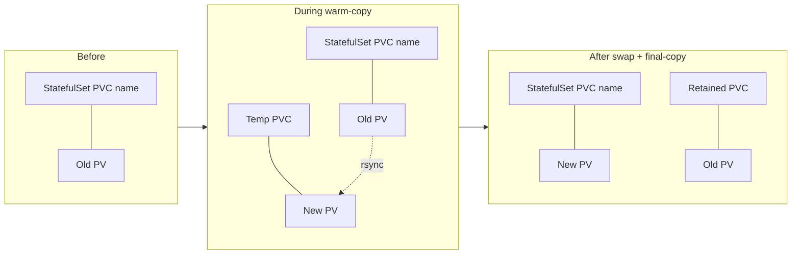
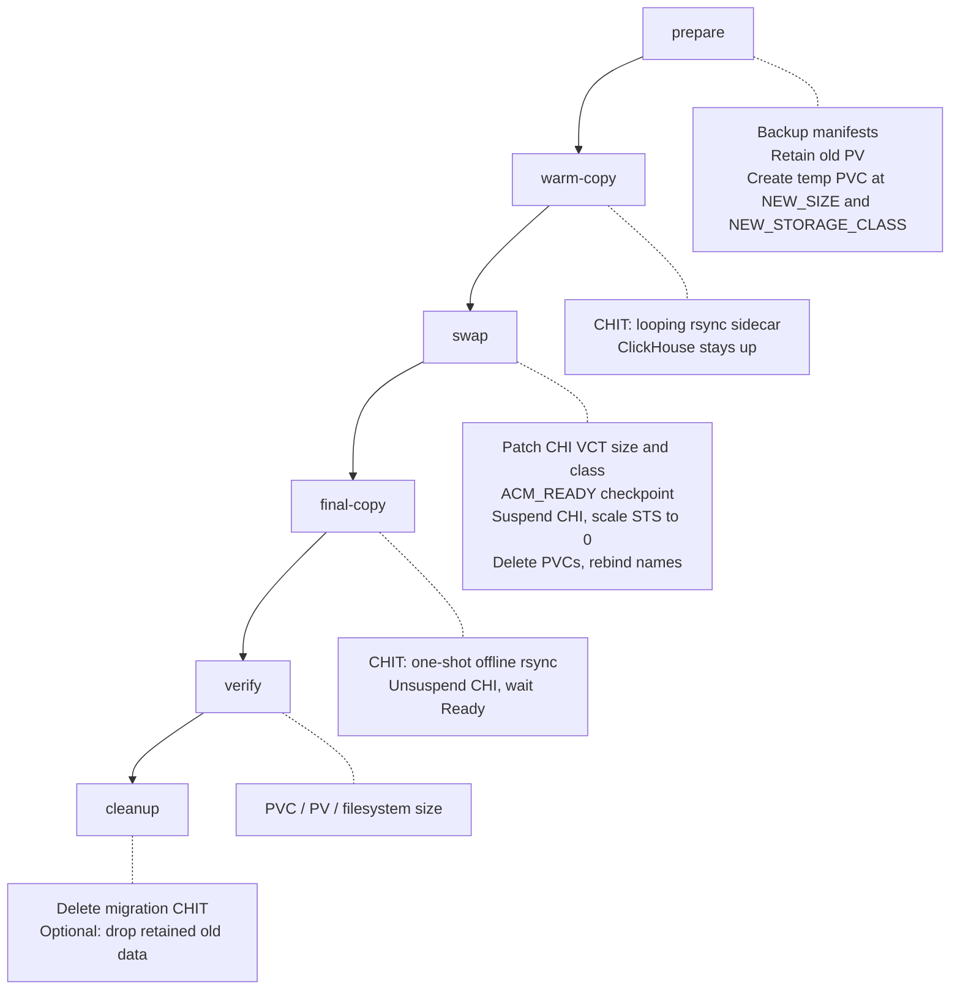
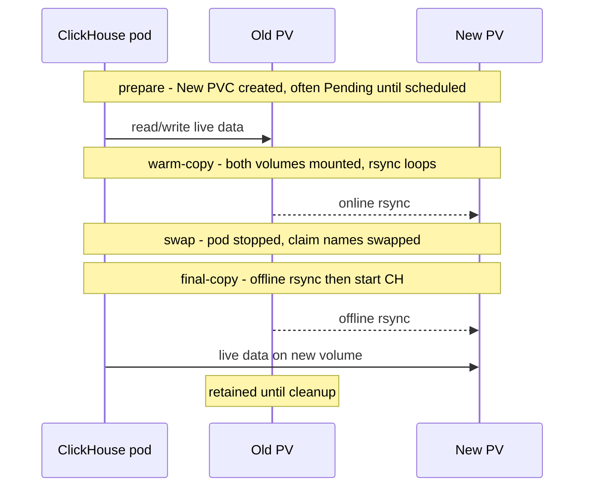

# ClickHouse Volume Downscale

Shrink a ClickHouse data volume when the storage class cannot shrink a PVC in place. The procedure replaces the large PVC with a smaller one, copies data with rsync, and keeps the old volume as a rollback source until you delete it.

The same procedure also **moves a volume to a different StorageClass**, at the same size or a smaller one, by setting `NEW_STORAGE_CLASS`. See [Changing the storage class](#changing-the-storage-class).

It targets clusters managed by the ClickHouse Operator (`ClickHouseInstallation`). On Altinity Cloud Manager (ACM), user also needs to update the desired volume size (and storage class, when it changes) in ACM so it does not re-expand the claim or revert the class after the swap. Same applies if CHI is managed by any external system or GitOps.

Prefer a second disk and ClickHouse `MOVE PARTITION` / storage policies when that meets the goal. Use this PVC-swap path only when the final layout must be a **single smaller volume**.

Automation lives in [`volume_downscale.sh`](volume_downscale.sh).

## When to use it

| Situation | Approach |
| --- | --- |
| Need more capacity or rebalance tables | Add a disk / storage policy; move partitions in ClickHouse |
| Must keep one volume, smaller than today | This procedure |
| Need a StorageClass that cannot be changed on an existing PVC (for example `pd-ssd` to a Hyperdisk class) | This procedure with `NEW_STORAGE_CLASS` |
| Provider supports PVC shrink | Prefer native shrink; do not use this runbook |
| Provider changes type, IOPS or throughput in place (most EBS changes on AWS, for example `gp2` to `gp3`, via VolumeAttributesClass or Elastic Volumes) | Prefer the in-place change; this runbook is rarely needed |

Hard requirements before you start:

- Used data fits in `NEW_SIZE` with headroom
- New and old PVs land in the same zone
- You can take a maintenance window for the offline final sync if single replica cluster is downscaled
- CHI (and ACM, if used) will accept `NEW_SIZE` as the desired size
- For a class change: the new StorageClass exists (ideally `volumeBindingMode: WaitForFirstConsumer`), and the node the pod runs on can attach that disk type. The warm-copy mounts the new disk on the node already running ClickHouse, so a disk the node cannot attach leaves the pod stuck in `Init` while the replica is meant to stay online. On GKE, for example, Hyperdisk Balanced cannot be attached to N2D machine types, and Hyperdisk Extreme on C3D needs at least 60 vCPUs. Check the provider's machine-type support before you start.

## Core idea

Kubernetes cannot safely rename a PV under a StatefulSet claim. The script therefore:

1. Provisions a **new PV** (smaller, and/or on the new StorageClass) under a temporary PVC
2. **Warm-copies** while ClickHouse still runs (most of the data)
3. Stops the replica, **swaps claim names** so the StatefulSet’s original PVC name points at the new PV
4. **Final-copies** offline (consistency)
5. Keeps the old large PV bound under a retained PVC name until you clean up



## Workflow

Phases map 1:1 to `volume_downscale.sh`. Typical run:

```bash
NS=<namespace> TARGET_STS=<statefulset> NEW_SIZE=<size> [NEW_STORAGE_CLASS=<class>] ./tools/volume_downscale.sh all
```

Or run phases one at a time: `derive` → `prepare` → `warm-copy` → `swap` → `final-copy` → `verify` → `cleanup`. Recovery helper: `bind-old-pv`.



### prepare

Discover CHI, PVC, PV, sizes; write backups under `disk-shrink-backup/<pod>/`; set the old PV reclaim policy to `Retain`; create the temporary PVC at `NEW_SIZE` (storage class `NEW_STORAGE_CLASS`, which defaults to the current class; same access modes; copies `spec.epc.altinity.com/*` annotations when present).

### warm-copy

Apply a `ClickHouseInstallationTemplate` that adds a restartable rsync **initContainer**. It mounts the live data volume read-only and the new PVC as the destination. ClickHouse keeps serving traffic; rsync may see vanished files—that is expected.

The script waits until rsync “Literal data” is small enough for a short offline window (`WARM_COPY_*` knobs), then asks for `WARM_COPY_READY`.

On every poll it prints the pod phase, the init-container state and the latest Warning events of the current pod. If the pod reports `FailedAttachVolume` or `FailedMount` `VOLUME_ERROR_EVENT_THRESHOLD` times (default 3), the script stops with exit code 31 instead of waiting out the timeout. The original PVC is untouched at that point; run `cleanup`, then delete the temporary PVC. The same check runs during `final-copy`.

### swap (destructive)

0. Guard: if the temp PVC's `storageClassName` differs from `NEW_STORAGE_CLASS`, stop with exit code 30 before changing anything. Pass the same `NEW_STORAGE_CLASS` to every phase.
1. Patch the CHI `VolumeClaimTemplate` to `NEW_SIZE` (and, only when the class changes, `storageClassName` to `NEW_STORAGE_CLASS`)
2. **ACM_READY**: confirm ACM (if used), CHI, and the temp PVC all show `NEW_SIZE` and the new class—otherwise ACM/operator can re-expand or revert the class later
3. Suspend CHI, drain ready markers, scale the StatefulSet to 0
4. Delete both PVC objects (PVs retained), clear `claimRef`, recreate:
   - Original PVC name → **new** PV, recreated with `NEW_STORAGE_CLASS`
   - Retained PVC name → **old** PV, with its old class (rollback source)

### final-copy

Replace the warm-copy CHIT with a one-shot offline rsync init container (old retained volume → new data mount). Unsuspend CHI. ClickHouse starts only after final sync succeeds and the pod becomes Ready.

### verify / cleanup

Check that PVC, PV capacity, and `df` all report `NEW_SIZE`; the PVC and PV storage class is printed as well. After validation, delete the migration CHIT and restore normal reclaim policy on the live PV. Delete the retained old-data PVC only when rollback is no longer needed (`DELETE_OLD_DATA` vs `SKIP`).

## Volume layout by phase



## Inputs

| Variable | Meaning |
| --- | --- |
| `NS` | Namespace |
| `TARGET_STS` | StatefulSet (e.g. `chi-…-0-0`) |
| `NEW_SIZE` | Desired capacity (e.g. `1500Gi`). Always required; for a class-only change pass the current size |
| `NEW_STORAGE_CLASS` | Optional. Target StorageClass; defaults to the current class. Must exist (exit 29 otherwise) |
| `VOLUME_ERROR_EVENT_THRESHOLD` | Optional. Number of `FailedAttachVolume` / `FailedMount` events that stops warm-copy or final-copy (default 3) |

Everything else (CHI name, PVC/PV ids, migration CHIT name, workdir) is derived. Optional overrides and timeouts are documented in `./tools/volume_downscale.sh` usage.

```bash
TARGET_STS=chi-otel-logs-otel-logs-0-0 \
NEW_SIZE=1500Gi \
./tools/volume_downscale.sh all
```

## Changing the storage class

Set `NEW_STORAGE_CLASS` and pass the current size as `NEW_SIZE`:

```bash
NS=<namespace> TARGET_STS=<statefulset> NEW_SIZE=<current size> NEW_STORAGE_CLASS=<class> ./tools/volume_downscale.sh all
```

Notes:

- Export the same `NEW_STORAGE_CLASS` for every phase when running them one by one. `swap` stops with exit code 30 if it differs from the temp PVC created by `prepare`.
- The operator reconciles the live PVC and does not rewrite its class from the `VolumeClaimTemplate`, so the other replicas of the cluster keep their class until you migrate them too. The patched template only affects PVCs created afterwards.
- A manual class patch on the CHI is not durable if an external system (ACM, GitOps) owns the desired class and pushes it back. Update the class there at `ACM_READY`, and re-check the CHI after cleanup.
- Hyperdisk-style classes may need provisioned IOPS or throughput; those come from StorageClass parameters, not from this script.

`--auto-confirm` / `AUTO_CONFIRM=yes` skips most typed gates **except** `ACM_READY`. Retained-data deletion still requires `DELETE_OLD_DATA` or `SKIP`.

## Prefer second disk when possible

If ACM (or your platform) can attach another volume:

1. Add the disk and a storage policy that includes both disks
2. Move heavy tables/partitions in ClickHouse
3. Monitor `system.parts` / `system.moves`

Stop there if that solves capacity. Continue with PVC swap only if a single smaller volume is mandatory.

## Risks and operator rules

- **Desired size must stay `NEW_SIZE`** in CHI and ACM after the swap, or the claim can grow again. Likewise keep the desired class at `NEW_STORAGE_CLASS`
- A node that cannot attach the new disk type leaves the pod in `Init`; the script stops with exit code 31 on repeated attach/mount errors
- **Do not delete** the retained old PVC until validation and retention are done—it is the rollback source
- CHITs need a `taskID` bump to force reconcile; pod templates merge by name
- Migration CHITs add `initContainers` only—leave regular containers to the operator
- Patch PV reclaim policies explicitly; do not assume they match CHI defaults

## Rollback (before deleting retained old data)

1. Suspend CHI, scale STS to 0
2. Swap claims so the StatefulSet PVC name points at the old large PV again
3. Restore CHI VCT (and ACM) to `OLD_SIZE` and, after a class change, to the old StorageClass
4. Resume CHI and re-sync if needed

After the retained PVC/PV are deleted, rollback from this procedure is gone.

## Script reference

| Phase | Role |
| --- | --- |
| `derive` | Print derived names/sizes |
| `prepare` | Discovery, backup, retain, temp PVC |
| `warm-copy` | Online rsync via CHIT |
| `swap` | Size patch, ACM gate, suspend, PVC rebind |
| `final-copy` | Offline rsync, resume |
| `bind-old-pv` | Recovery if retained PVC naming conflicts |
| `verify` | Size checks |
| `cleanup` | Remove CHIT; optional old-data delete |
| `all` | Full pipeline |

### Exit codes added for class changes

| Code | Meaning |
| --- | --- |
| 29 | `NEW_STORAGE_CLASS` does not exist |
| 30 | `swap`: `NEW_STORAGE_CLASS` differs from the temp PVC's class (nothing was changed) |
| 31 | Repeated `FailedAttachVolume` / `FailedMount` events during warm-copy or final-copy |
